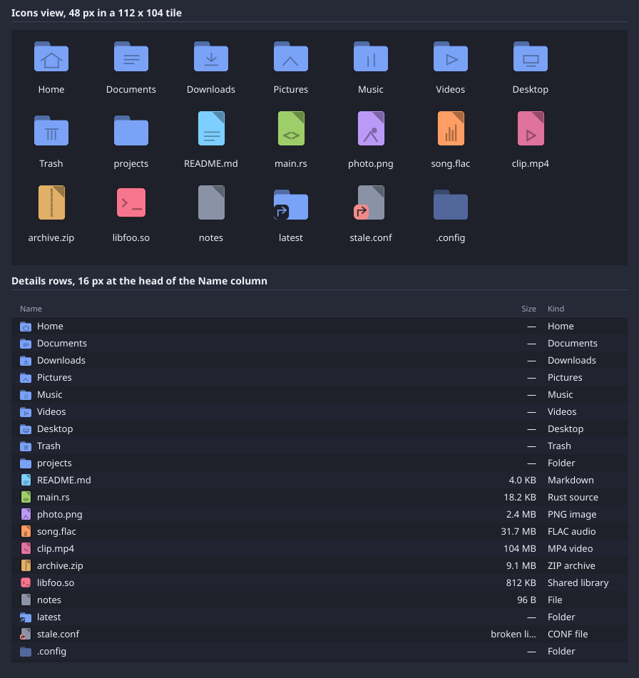
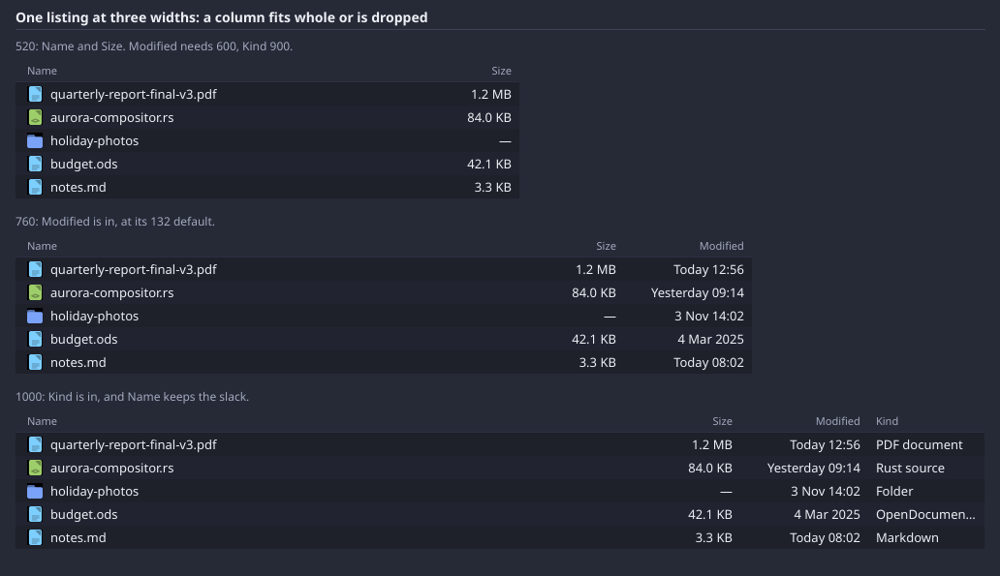
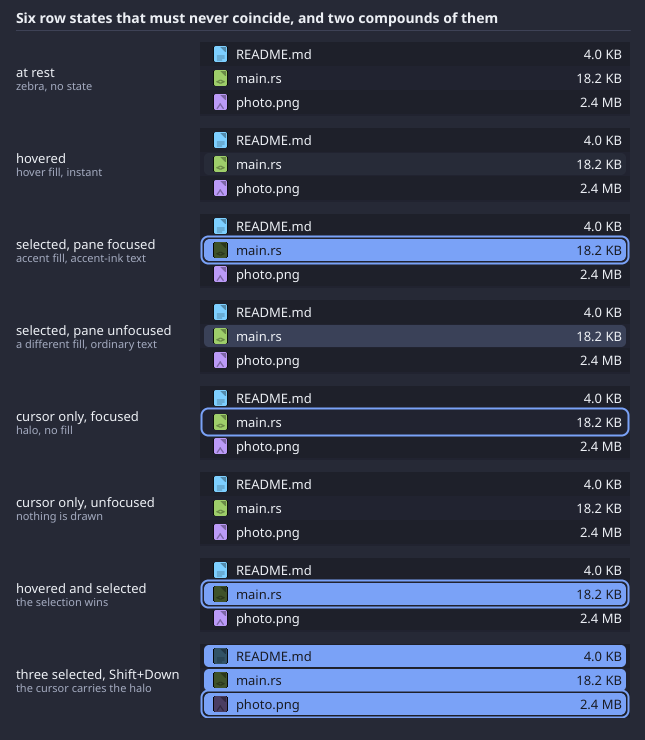

# Atlas: design specification

Status: design, 2026-11-07, revised the same day after the user's review (focus rings are in;
icons may come from vector and bitmap files; motion is a first-class foundation; the work is
staged for periodic review). This is the contract the next build of Atlas is implemented from
and reviewed against. Every number in it is a number to check, not a suggestion; where the toolkit
cannot yet express something the document says so (section 11) rather than assuming it.

What it is written against: the frame of Atlas as it runs today (a text-labelled toolbar, a
second "Atlas" heading under the window's own title, a three-entry sidebar, a details list whose
Modified column is cut off mid-value, `--` for every folder size, and the same blue folder on
every row), `kits/ui/demo/atlas.cpp`, `kits/ui/filebrowse.h`, `kits/ui/ui.h`,
`contracts/theme/aurora-glass.toml`, `docs/aurora-ui.md`, `docs/visual-system.md` and
`docs/file-navigator-plan.md`. Where this document and `docs/aurora-ui.md` disagree, this one is
the later word for Atlas and says why at the point of disagreement.

How to read it: sections 1 to 9 are in the order an implementer works through them. Each ends
with **Checks**, the things a reviewer compares against a screenshot or a scripted run. Section
10 is the staged plan, each stage ending at something the user can open and judge. Section 11
lists what the toolkit must gain. Section 12 is the review checklist in one place. "Phase 1, 2,
3" in the body are ambition tiers; section 10 maps them onto the stages.

Units: logical pixels at scale 1.0 unless stated. `u` is the toolkit's spacing unit, 8. Font
sizes are the resolved size at the base of 13 (section 3.1). Colours are given as sRGB hex and
as Oklab `[L, a, b]`, converted with the compositor's own rule (`theme.rs oklab_to_u8`), so a
token written into the theme file produces exactly the hex beside it.

---

## 1. The point of view

Atlas is the window through which a person sees what they have, and it is honest about what it
knows. It is there on the first frame with the names, and it fills in; it never makes the person
wait for a value they did not ask for, and it never shows a value it does not have (a cell that
is not known reads *unknown*, never blank, never a guess). Every row carries its type on its
face: a folder, a document, an image, a piece of code, an archive, a broken link are told apart at
a glance, without reading the name, because the icon is information and not decoration. Every
action shows its authority before it is taken: a verb that writes, destroys or leaves the machine
says so in the menu, and a drop into a sandboxed app is the grant, not a copy. The chrome is quiet
so the content is loud: one toolbar, one status line, hairlines not boxes, and a sidebar that is
a map of places rather than a second copy of the tree. It is dense like Dolphin and calm like
Finder, and it is driven from the keyboard as completely as from the mouse.

What that rejects: a dashboard with cards and headings; a terminal with a list in it; a web page
with a shadow on everything; a toolbar of words; a tree in the sidebar that starts at `/`; a
spinner over an empty pane; a generic icon on every row; a confirmation dialog in place of a
trash; an animation that moves a row the person is reaching for.

**Checks.** C1.1 The window has one title ("Atlas" in the compositor's bar in Phase 1; the folder
name from Phase 2, section 2.1) and no second heading inside the client area. C1.2 No two rows of
different kind share an icon. C1.3 No cell that has a value is blank; no cell that lacks one
shows a value.

---

## 2. Layout and information architecture

### 2.1 Regions

Top to bottom, left to right. Heights and widths are fixed values in logical px; the split
ratios are `State<float>` the app persists.

```
+--------------------------------------------------------------------------------+
| TOOLBAR  44                                                                    |
+------------+-------------------------------------------------+-----------------+
| SIDEBAR    | CONTENT                                         | PREVIEW         |
| 200 default| header 26 + rows 24  (details)                  | 280 default     |
| 160 min    | or tiles 112 x 104   (icons)                    | 220 min         |
| 360 max    | 320 min, takes the remainder                    | 480 max         |
+------------+-------------------------------------------------+-----------------+
| STATUS  26                                                                     |
+--------------------------------------------------------------------------------+
```

- **Toolbar**, 44 tall, chrome colour, 1 px hairline below. Contents and order, left to right,
  with 8 px padding at both ends and 4 px between buttons in a cluster:
  1. Sidebar toggle, icon button 28x28.
  2. Navigation cluster: Back, Forward, Up, icon buttons 28x28 (section 6.9).
  3. 12 px gap.
  4. Location: the breadcrumb (section 6.10), flexible, minimum 200. In edit mode the same slot
     holds the path field; the swap is `Either`, in place, no vertical motion.
  5. 12 px gap.
  6. Filter field, 180 wide, 28 tall (section 6.5). Below window width 720 it collapses to a
     28x28 icon button that expands the field over the breadcrumb's right end when pressed.
  7. View menu button 28x28 with a 10 px chevron (section 6.9): list / icons, sort by, columns,
     hidden files.
  8. Preview toggle, icon button 28x28.
  The toolbar never wraps and never scrolls. Overflow order: the filter field collapses to its
  icon first; then the breadcrumb elides its middle segments (section 6.10). Nothing else gives.
- **Sidebar** (section 6.11): default 200, floor 160, ceiling 360, resized by the `HSplit`
  divider (grip drawn, 3 px slop each side). Sections, in order: Places, Filesystem, with
  Devices and Queries arriving in later phases (section 10). Collapsible with the toolbar toggle
  and `Ctrl+B`; `RevealX`, section 7.
- **Content**: the current view (section 5). Never collapses; floor 320. Takes every pixel the
  other regions do not.
- **Preview** (section 6.12): default 280, floor 220, ceiling 480. Shown by the toolbar toggle
  or `Space`; `RevealX`. Not a split in Phase 1 (appearing is not resizing); a divider arrives
  with Phase 2's inspector.
- **Status bar**, 26 tall, chrome colour, 1 px hairline above. Left: the count or selection
  summary, caption size, secondary ink. Right: the last action or error, caption, secondary ink;
  an error is in `destructive` ink and starts with "Refused:" or "Failed:". The two are laid out
  as left text, `Spacer`, right text, and the right text elides its middle when the two would
  touch. The display-integrity rule applies here: two halves of one line are never drawn without
  each knowing the other's width.

The window's minimum size is 480x320. The default first-run size is 960x640.

**Window title.** The title the compositor draws is the current folder's leaf name; the home
folder is titled "Home" rather than the login name, and "/" is titled "Filesystem". This needs
`au_wl_win_set_title` (section 11); until it exists the title is
"Atlas" and nothing inside the window repeats it.

### 2.2 Behaviour across widths

Three bands on the window's logical width. The rule is: content first, sidebar second, preview
third, and the toolbar's location field keeps at least 200.

| band | width | what happens |
|---|---|---|
| small | < 600 | Sidebar is collapsed automatically (its toggle re-opens it as an overlay in Phase 2; in Phase 1 it re-opens in place and the content shrinks to its floor). Preview cannot be open: toggling it is refused with a status line "Preview needs a wider window". Filter is icon-only. Details view shows Name and Size only. |
| medium | 600 to 899 | Sidebar open by default. Opening the preview at < 800 collapses the sidebar first; closing the preview restores it. Details shows Name, Size, Modified. |
| large | >= 900 | Everything may be open at once. Details adds Kind. The preview defaults to 280 and may be widened to 480. |

Transitions between bands happen on resize and are instant: a resize is a full frame already,
and a reveal animation stacked on top of a live resize would fight the person's hand. The
collapsed state caused by a band change is remembered separately from the person's own toggle,
so growing the window back past the threshold restores what they had, and shrinking it does not
overwrite their preference.

### 2.3 Density

Details rows are 24 tall at the base size and scale with it: `row = round(text_h + 6)`, which is
24 at 13 px with the Noto Sans metrics the kits load (ascent + descent = 17.7 px at 13). The
sidebar's rows are 26. Column headers are 26. Tiles in icons view are 112x104 at the 48 px icon.
All of these are fixed from the first
frame of a directory and do not change when values arrive (decision 0023, rule 3). There is no
"compact" or "comfortable" setting: one density, chosen to put 24 rows in a 640-tall window with
the chrome, which is what Dolphin's default gives.

**Checks.** C2.1 At 960x640 the toolbar is 44 tall, the status bar 26, the sidebar 200 and the
content header 26 with 24 px rows; measure on the screenshot. C2.2 At 520x400 the sidebar is
collapsed, the filter is an icon, and the details view shows exactly Name and Size with no
column cut mid-value. C2.3 At 1280x800 with the preview open, sidebar, content and preview are
all visible and no column is clipped mid-value. C2.4 The status bar's right text never overlaps
its left text at any width down to 480.

---

## 3. Visual language

### 3.1 Type

The toolkit's `Env::size` is the base and `TextStyle::size` is a multiplier, so the scale is
given as both. Atlas sets `env().size = 13` explicitly on startup (the system "plain" font
reports 12, which is a size the shell abandoned for 14; 13 is Finder's and Dolphin's list size
and the one this spec's row heights are derived from). Weights are 400 and 700 only (the kits
cannot assume a variable font; a synthetic weight is a smear). Italic is used in exactly one
place, the status bar's "last action", and nowhere else.

| token | multiplier | px at base 13 | weight | used for |
|---|---|---|---|---|
| `caption` | 0.85 | 11 | 400 | column headers, sidebar section headers, status bar, badges, type-ahead pill, empty-state body, rename collision note |
| `body` | 1.0 | 13 | 400 | rows, tiles, sidebar items, breadcrumb, fields, buttons, menu items, preview body |
| `body-strong` | 1.0 | 13 | 700 | the default item in a menu; the preview's file name |
| `emphasis` | 1.15 | 15 | 400 | not used in Phase 1; reserved for the inspector's section titles (Phase 2) |
| `title` | 1.3 | 17 | 700 | empty-state and error-state headings only |

Two things are deliberately not bold: the sorted column's header (it changes ink, not weight)
and a selected sidebar item (the fill says it; a bolder label would change its width).

Line height: single-line rows are placed by baseline at `row_h * 0.72` as the toolkit does;
multi-line text (`TextView`) at 1.35 x size. Tabular figures are not available from the text
stack, so numeric columns are right-aligned (section 5.1) and that is what keeps them readable.

### 3.2 Spacing

The scale is the unit and its halves: `2, 4, 8, 12, 16, 24` (`u/4, u/2, u, 1.5u, 2u, 3u`).
Nothing in Atlas is laid out at a value off this scale except the three fixed heights (44, 26,
24) and the icon sizes, which are chosen for pixel reasons (section 4.3).

- Row: 12 from the pane's left edge to the icon, 16 icon, 8 to the name. 8 between a cell's
  text and the next column's left edge (the cell clip is `column width - 8`).
- Tile: 8 gutter between tiles, 10 from tile top to icon, 8 from icon to label, 6 inside edge
  for the label.
- Sidebar: 12 left padding at depth 0, 16 per depth level, 8 between icon and label, 8 between
  a section header and its first item, 16 between the last item of one section and the next
  header.
- Toolbar and status bar: 8 end padding, 4 inside a cluster, 12 between clusters.
- Preview: 16 padding all round; 8 between the icon block and the name; 4 between the name and
  the detail line; 12 between the detail line and the body.

### 3.3 Corner radii

| radius | used for |
|---|---|
| 4 | rename field, checkbox, badges on icons, the drag ghost's count badge is a circle |
| 5 | details-row selection and hover fill (inset 4 horizontally, 1 vertically) |
| 6 | buttons, fields, sidebar selection (inset 6 horizontally), breadcrumb segment hover, menu row hover |
| 7, 8, 10 | the focus halo around a row, a sidebar item or button, a tile (the element's radius + 2) |
| 8 | tiles' selection fill, menus, the type-ahead pill, preview thumbnail frame |
| 12 | the window's own corners: the compositor's, not ours |

Icons' own radii are in section 4.3.

### 3.4 Elevation and glass

Inside the window there is one plane. Regions are separated by 1 px hairlines in `hairline`,
never by shadows or by boxes with borders. The only things above the plane are the popup menu
(its own Wayland surface: the compositor's chrome glass and, when the compositor gains shadows,
level 2 of `docs/visual-system.md` section 4) and the drag ghost (drawn last into the window
surface, no shadow, 85% opacity, section 6.6).

Glass: the window is **opaque in Phase 1**. The client presents XRGB8888, so no compositor glass
can show through it, and decision 0023's promotion rule (open opaque, promote when there is
budget) is met trivially. Phase 2 makes the **sidebar** a glass region (section 11 lists what
that needs): the sidebar's own fill is composited at alpha 0.90 over the compositor's blur. That
alpha is a floor, not taste: with the sidebar fill at Oklab L 0.228 (relative luminance Y 0.012)
and a white backdrop, the worst-case composite luminance is `0.10 * 1.0 + 0.90 * 0.012 = 0.111`,
and primary ink (Y 0.86) gives `(0.86 + 0.05) / (0.111 + 0.05) = 5.7:1`, over the 4.5:1 floor.
Secondary ink (Y 0.40) gives 2.8:1 over that same backdrop and fails (it would need alpha 0.97
to pass, which is no longer glass), so **on the glass sidebar every piece of text is in primary
ink**: section headers are told from items by size (`caption`) and position, not by a dimmer
colour. The arithmetic is in linear light, which is the conservative case; the compositor
blends client alpha in encoded space, where the result is darker still. The toolbar, content
and status bar stay opaque in every phase: text on blurred imagery is the thing the visual system
refuses for body text, and a
file list is body text.

The promotion to glass, when it exists, changes alpha and nothing else: no reflow, no size
change, no shift of a row. It eases over 200 ms (section 7).

### 3.5 Borders and lines

- Hairlines: 1 px, `hairline`, between toolbar and content, between sidebar and content (the
  split divider draws it plus its grip), between content and preview, between content and
  status bar. Under the details header: 1 px `divider`.
- Zebra: even rows are `content`, odd rows are `content-alt` (section 3.6), full width of the
  pane, drawn under hover and selection.
- Fields: 1 px `hairline` border at rest, 2 px `accent` when focused, 1 px `accent` when
  holding a non-empty filter, 1 px `destructive` when holding a refused rename.
- Focus ring: the halo of section 6.3, 2 px `focus` with a 1 px gap of the surface colour
  between it and the element it surrounds, radius = the element's radius + 2. It is drawn
  around the focused *element* (the cursor row, tile, sidebar item, button or field), never as
  a rectangle around a whole pane: the 1 px frame the current build draws around the focused
  pane is the single largest reason that frame reads as plain, and it is gone.
- Drop target: 2 px `accent` inset 1 px inside the row, tile, sidebar item or pane, plus a fill
  of `accent` at 12% alpha.

### 3.6 Colour roles

Two schemes. Dark is the default because the shell is dark (the desktop background is Oklab L
0.27 to 0.15 and every piece of chrome glass is clamped to Y 0.16). Light exists so that Atlas
follows a future shell setting and so the palette is proven to work both ways now rather than
retrofitted. The scheme is chosen by a new theme key, `[theme.ui] scheme = "dark" | "light"`,
read once at startup like the Interface Kit's table, and overridden by `AURORA_UI_SCHEME`. In
Phase 1 the dark values below may be compiled in as `Env` defaults; the theme reader is Phase 2
(section 10).

Mapping onto the toolkit's `Env`: `fg = text`, `dim = text-2`, `accent = accent`,
`surface = chrome`, `surface_hi = raised`. Everything else is new and named here. WCAG 2
contrast is computed on the decoded sRGB values; the floors are 4.5:1 for text, 3:1 for
non-text and for the tertiary ink, which is only ever used for disabled or placeholder text.

| role | dark hex | dark Oklab | light hex | light Oklab | contrast (dark / light) | used for |
|---|---|---|---|---|---|---|
| `chrome` | `#262936` | `[0.284, 0.002, -0.024]` | `#EDEEF1` | `[0.949, 0.000, -0.004]` | | toolbar, status bar, menu button at rest |
| `content` | `#1E202A` | `[0.246, 0.002, -0.019]` | `#FCFCFD` | `[0.991, 0.000, -0.001]` | | details and icons pane, preview |
| `content-alt` | `#212330` | `[0.260, 0.003, -0.024]` | `#F7F8FA` | `[0.979, 0.000, -0.003]` | | odd rows (zebra) |
| `sidebar` | `#1A1C25` | `[0.228, 0.002, -0.018]` | `#F2F3F6` | `[0.964, 0.000, -0.004]` | | sidebar fill |
| `field` | `#161820` | `[0.211, 0.001, -0.016]` | `#FFFFFF` | `[1.000, 0.000, 0.000]` | | text fields, rename field |
| `raised` | `#343849` | `[0.344, 0.002, -0.030]` | `#E1E3E9` | `[0.916, 0.000, -0.008]` | | button hover, header hover, breadcrumb segment hover, menu row hover, scroll thumb |
| `hover` | `#272B38` | `[0.291, 0.001, -0.024]` | `#F0F1F5` | `[0.959, 0.000, -0.005]` | | row and tile hover fill |
| `hairline` | `#3E4256` | `[0.384, 0.004, -0.034]` | `#C9CCD6` | `[0.846, 0.001, -0.014]` | none required: a separator is not a component boundary | region separators, field borders at rest |
| `divider` | `#2C3040` | `[0.312, 0.002, -0.029]` | `#E3E5EB` | `[0.922, 0.000, -0.008]` | | under the column header, menu separators |
| `text` | `#ECEFF4` | `[0.951, -0.001, -0.007]` | `#23262E` | `[0.269, 0.000, -0.016]` | 14.1 / 14.8 on `content` | names, labels, values |
| `text-2` | `#A3AABF` | `[0.739, 0.001, -0.031]` | `#5B6170` | `[0.493, -0.001, -0.025]` | 7.0 / 6.0 on `content`; 6.2 / 5.3 on `chrome` | column headers, section headers, dates, sizes, status bar, breadcrumb ancestors, "unknown" |
| `text-3` | `#6E758A` | `[0.564, 0.000, -0.034]` | `#8A90A0` | `[0.654, 0.000, -0.025]` | 3.5 / 3.1 on `content` | disabled buttons, placeholders, the em dash in a folder's size |
| `accent` | `#7AA2F7` | `[0.719, -0.013, -0.131]` | `#3B6FE0` | `[0.569, -0.021, -0.180]` | 6.4 / 4.5 on `content` | focused selection fill, drop targets, the type-ahead pill, the active filter border, the sort chevron |
| `accent-ink` | `#181A22` | `[0.219, 0.001, -0.016]` | `#FFFFFF` | `[1.000, 0.000, 0.000]` | 6.9 / 4.6 on `accent` | text on a focused selection, text in the type-ahead pill |
| `focus` | `#7AA2F7` | `[0.719, -0.013, -0.131]` | `#3B6FE0` | `[0.569, -0.021, -0.180]` | non-text: 6.4 / 4.5 on `content`, 5.7 / 4.0 on `chrome`, 6.7 / 4.2 on `sidebar`, 4.0 / 3.5 on `selection-unfocused` | the focus halo (section 6.3); the same value as `accent` today, a separate token so it can diverge |
| `selection-unfocused` | `#3A4158` | `[0.379, 0.001, -0.041]` | `#DCE0EA` | `[0.907, 0.000, -0.014]` | `text` on it: 8.8 / 12+ | selection fill when the pane does not have focus |
| `destructive` | `#F08A8A` | `[0.743, 0.117, 0.044]` | `#C43B3B` | `[0.554, 0.158, 0.073]` | 6.7 / 5.1 on `content` | destructive menu items, refused-rename border and note, error text in the status bar, broken-link badge |
| `warning` | `#E0AF68` | `[0.784, 0.027, 0.102]` | `#9A6500` | `[0.550, 0.034, 0.112]` | 8.1 / 4.8 | the "n unknown" sort note, cross-filesystem refusals |
| `success` | `#9ECE6A` | `[0.795, -0.090, 0.107]` | `#2E7D32` | `[0.523, -0.109, 0.079]` | 8.9 / 5.0 | reserved: a completed long operation (Phase 3) |

Effect marks in menus (`Read` none, `Write` a pen glyph, `Destructive` red label, `External`
an arrow-out glyph) keep the toolkit's drawing; the destructive label colour is `destructive`
above, which replaces the toolkit's compiled-in `{240,138,138}` (the same value, now named).

File-kind colours are in section 4.2. No coloured text is ever placed on glass (visual system
section 6), which is one more reason the content pane stays opaque.

**Checks.** C3.1 Column headers are 11 px, not bold, in `text-2`; the sorted header is in `text`.
C3.2 Rows are 13 px regular; no row text is bold. C3.3 Sample `content` and `content-alt` on
adjacent rows; they differ, and `hover` is lighter than both. C3.4 The focused selection fill is
`accent` and its text is `accent-ink`; click the sidebar and the content's selection becomes
`selection-unfocused` with `text` on it. C3.5 No pane draws a 1 px rectangle around its whole
frame when focused; after an arrow key the cursor row carries the 2 px halo with its 1 px gap
(section 6.3), and after a pointer press on a row the halo is absent. C3.6 On the Phase 2 glass
sidebar no text is in `text-2`; headers are
`caption` in `text`.

---

## 4. Iconography

The loudest defect in the current frame is one icon on every row. The fix has two halves. The
**procedural family** below is the floor: nine kinds with marks and badges, drawn from canvas
primitives, always available, and enough that the eye can sort a listing without reading it.
Above it, section 4.6 lets an icon come from a **file**, vector (SVG, and HVIF when its decoder
lands) or bitmap (PNG), from an icon theme, with the procedural icon as the fallback at every
step, and with the rule that Atlas never decodes an icon file in its own process. Thumbnails
from `preview@v1` (Phase 3) sit above both for the grid and the preview, never for the 16 px
details row.

### 4.1 Kinds

Classification is from the name, which is all a listing has before a stat lands, plus two facts
`readdir` or the stat gives for free: directory-ness (`d_type` or the stat on a link) and, once
the worker has stated the row, the executable bit. Content sniffing is a read of a file nobody
opened and is refused. The Kind column (section 5.1) and the icon come from the same table so
they cannot disagree.

| kind | extensions (lower-cased; the table is data, section 9.3) | Kind column label |
|---|---|---|
| Folder | directory | "Folder"; special folders say "Home", "Desktop", ... |
| Document | `txt md rst pdf doc docx odt rtf html htm tex epub` | "Text", "Markdown", "PDF document", "Word document", "OpenDocument text", "HTML" and so on; unknown members say "Document" |
| Code | `c h cc cpp hpp cxx rs go py js ts tsx jsx java kt swift sh bash fish zsh rb lua toml json yaml yml xml ini cfg cmake mk make nix sql` | "C source", "C header", "Rust source", "Python script", "JSON", "TOML" ... |
| Image | `png jpg jpeg gif svg webp bmp ppm tiff tif heic avif ico` | "PNG image" ... |
| Audio | `mp3 flac ogg oga wav aac m4a opus mid` | "MP3 audio" ... |
| Video | `mp4 mkv webm mov avi m4v` | "MP4 video" ... |
| Archive | `zip gz xz bz2 tar tgz zst 7z rar rpm deb` | "ZIP archive", "Tar archive" ... |
| Executable | `so a o ko exe appimage`, or any file whose stat shows an execute bit | "Shared library", "Object file", "Executable" |
| Generic | anything else, and names with no extension | "File"; with an extension: the upper-cased extension + " file" |

Badges, drawn over the kind icon at the bottom-left corner:

- **Link**: a small curved arrow in `text` on a 4-radius plate of the pane colour, for any
  symlink. A link to a folder is a Folder with the badge.
- **Broken**: the same arrow in `destructive`, and the name is drawn in `text-2`. Size reads
  "broken link" in `destructive`.
- **Hidden**: no badge; the whole icon and name are drawn at 55% opacity (`text` mixed toward
  the pane colour). Only visible when hidden files are shown.

### 4.2 Colour

One hue per kind, used for the icon's silhouette; the inner mark is the same hue at 0.6 of its
luminance (the toolkit's current `dim`, `c * 2/3`), which is what keeps the mark readable on
both schemes. On a focused selection the whole icon is drawn in the kind hue at 0.4 luminance
(the toolkit's `on_accent` variant); the hue survives, the icon does not fight the fill.

| kind | dark | light |
|---|---|---|
| Folder | `#7AA2F7` `[0.719, -0.013, -0.131]` | `#3B82F6` `[0.623, -0.033, -0.185]` |
| Document | `#7DCFFF` `[0.820, -0.059, -0.087]` | `#0E8AC9` `[0.604, -0.068, -0.117]` |
| Code | `#9ECE6A` `[0.795, -0.090, 0.107]` | `#4C9A2A` `[0.614, -0.122, 0.110]` |
| Image | `#BB9AF7` `[0.751, 0.066, -0.117]` | `#8B5CF6` `[0.606, 0.085, -0.202]` |
| Audio | `#FF9E64` `[0.787, 0.087, 0.106]` | `#E8731E` `[0.681, 0.109, 0.130]` |
| Video | `#E0729E` `[0.691, 0.144, -0.009]` | `#C2437A` `[0.575, 0.169, -0.009]` |
| Archive | `#E0AF68` `[0.784, 0.027, 0.102]` | `#B97A12` `[0.630, 0.040, 0.124]` |
| Executable | `#F7768E` `[0.723, 0.156, 0.028]` | `#D7375F` `[0.590, 0.192, 0.039]` |
| Generic | `#8A92A6` `[0.660, -0.001, -0.031]` | `#7D8596` `[0.616, -0.002, -0.027]` |

Folder stays the accent hue on purpose: folders are the map and the accent is the colour of
"where you are".

### 4.3 Anatomy by size

Sizes are 16 (details rows, sidebar, breadcrumb root, drag ghost at 24), 48 (grid default,
preview header), 80 (grid large, Phase 2). All geometry is a fraction of the box so the same
routine draws every size; radii are stated per size because a fraction of 16 rounds badly.

| element | 16 | 48 | 80 |
|---|---|---|---|
| Folder tab: x 0 to 45% w, y 12% to 35% h; body: y 26% to 100% | radius 2 / 2 | 4 / 4 | 6 / 6 |
| Page: x 12% to 88% w, full height, fold at top-right 34% of w | radius 2 | 4 | 6 |
| Inner mark stroke | 1.5 px | 2.5 px | 3.5 px |
| Badge plate | 7x7 at bottom-left, radius 2 | 16x16, radius 4 | 24x24, radius 6 |

Marks, drawn in the 0.6-luminance hue inside the page's lower 55%:

- Document: three horizontal lines at 60%, 72%, 84% of h, lengths 56%, 56%, 36% of the page
  width, left-aligned at 24% w.
- Code: two chevrons `<` `>` centred at 70% h, each 22% of the page width wide; at 16 px they
  are two 3 px strokes.
- Image: a filled circle (sun) of diameter 18% w at (62% w, 55% h) and a mountain drawn as
  two strokes from (24% w, 86% h) to (48% w, 60% h) to (72% w, 86% h); the triangle is not
  filled (there is no polygon fill primitive) and at 16 px the mountain alone is drawn.
- Audio: four vertical bars at 32%, 44%, 56%, 68% w, heights 18%, 36%, 28%, 44% of h, bottoms
  at 84% h. At 16 px: three bars.
- Video: a play triangle as three strokes forming a triangle with its apex at (66% w, 70% h)
  and base from (36% w, 56% h) to (36% w, 84% h); at 16 px the apex stroke only, 2 px.
- Archive: a vertical dashed line down the page centre from 10% to 90% h, dash 8% h, gap 6% h;
  at 16 px the dashes are 2 px / 2 px.
- Executable: not a page. A rounded square inset 8% all round (radius 3 / 8 / 12) with a `>_`
  mark: a chevron at (30% w, 50% h) and a 24%-w underline at (54% w, 68% h).
- Generic: the page with no mark.
- Special folders (Phase 1: Home, Desktop, Documents, Downloads, Pictures, Music, Videos, Trash;
  matched by the XDG user-dirs names and falling back to the English names): the folder body
  carries one mark in the 0.6 hue: a house outline (Home), a 3-line document (Documents), a
  down arrow over a short baseline (Downloads), the image mountain (Pictures), two audio bars
  (Music), the play triangle (Videos), a 3-line bin (Trash), a bare rectangle with a 1 px lower
  band (Desktop). At 16 px the marks are drawn; at 48 they are drawn at the 48 stroke.

<figure class="wide">

<figcaption>Generated, not drawn: these are the pixels <code>kits/ui</code> produces today, at scale 1.0 (<a href="images/specimen-icons-1.45x.png">and at 1.45</a>), so this sheet stays honest as the toolkit changes. The one picture C4.2 asks for: eight files whose kind you can tell with the names covered.</figcaption>
</figure>


### 4.4 Behaviour by view

- **Details**: 16 px, at x = 12, vertically centred in the 24 px row; the name follows 8 px
  later. The icon is drawn from the cache (one blit per row). A hidden entry's icon is at 55%
  opacity, which is a second cache variant, not a per-frame blend.
- **Icons**: 48 px, centred horizontally in the 112-wide tile, top at y = 10. Selected tile:
  the on-accent variant. Large tiles (Phase 2): 80 px, tile 144x136.
- **Sidebar**: 16 px before the label, Places use the special-folder marks; the Filesystem
  tree uses the plain folder; mounted devices (Phase 2) a drive glyph.
- **Preview header**: 48 px, left-aligned, with the name and kind beside it.
- **Drag ghost**: 24 px, which is a fourth cache size, created on first drag.

### 4.5 Cost rule

Every icon is rasterised once per `(kind, mark, variant, size, scale)` and blitted thereafter,
which the toolkit already does (`IconCache`) and which measured 8.4 ms to 3.2 ms for a hundred
tiles. The family above adds marks and badges but no per-frame geometry: the badge is part of
the cached image (variant = link / broken / none) and opacity is a variant, not a blend. The
cache is bounded by kinds x variants x sizes (about 9 x 12 x 4 at one scale) and is allowed to
grow with the window's scale; it is never evicted per frame.

### 4.6 Icon sources: procedural, vector, bitmap, per-file

Every icon Atlas draws is a rasterised ARGB image at a device size, looked up in one cache by
`(source id, logical size, scale)`. Where the pixels come from is a **source**, and there are
four, in this precedence:

1. **Per-file**: a thumbnail from `preview@v1` (Phase 3), for images, PDFs and video, in the
   grid and the preview only. Keyed by `(path, mtime, size, target)`.
2. **Theme, by type**: the icon theme's entry for the exact MIME type or extension
   (`image/png`, `rs`).
3. **Theme, by kind**: the theme's entry for one of the nine kinds (`folder`, `document`,
   `code`, ... and the special folders `folder-home`, `folder-pictures`, ...).
4. **Procedural**: section 4.3. Always present; never fails; the floor.

The first source that *has* an icon wins, and a source that has one but has not rasterised it
yet is skipped for this frame and the next one down is drawn instead, so a row never waits on a
file: a theme icon appears on a later frame in place of the procedural one, which is an icon
change on a row (colour and shape, never size) and is allowed. Badges (link, broken) and the
hidden-file opacity are composited by Atlas over whatever source won; the on-accent variant is
applied to procedural icons only, a file icon is drawn unchanged on the selection fill.

**The theme.** A directory at `/usr/share/aurora/icons/<name>/` or
`$XDG_DATA_HOME/aurora/icons/<name>/`, chosen by `[theme.icons] theme = "<name>"` and overridden
by `AURORA_UI_ICONS`. It holds an `index.toml` and files:

```toml
[kinds]                       # kind id -> file; any kind not listed falls to procedural
folder = "folder.svg"
folder-pictures = "folder-pictures.svg"
document = "document.svg"
[mime]                        # exact MIME type -> file; wins over the kind
"image/png" = "image-png.svg"
[ext]                         # extension -> file; wins over the kind, loses to mime
rs = "code-rust.png"
```

A file is `name.svg` (vector) or `name-<px>.png` (bitmap at that logical size: `-16`, `-24`,
`-48`, `-80`, `-256`; a theme supplies the sizes it has). Icons are read from the theme
directories and from **nowhere else**: not from the directory being browsed, not from a
`.directory` file, a `folder.jpg`, an `Icon\r`, a desktop entry or an extended attribute. An
icon file can arrive on the machine inside a folder the user merely opened, and the only
defence that holds is that a folder's contents are never a source of its own presentation.

**Vector format.** SVG, in a static profile: `svg`, `g`, `path`, `rect`, `circle`, `ellipse`,
`line`, `polyline`, `polygon`, `linearGradient`, `radialGradient`, `stop`, `defs`, `clipPath`,
`use` of an id in the same file; attributes for fill, stroke, opacity, transform, `viewBox`.
Refused, and the whole file with them: `script`, `style` and any CSS, `text` (it needs fonts and
a font is a second parser), `image`, `filter`, `foreignObject`, animation elements, any `href`
or `xlink:href` that is not a same-document `#id`, any external entity or DOCTYPE, any
namespace but SVG's. Limits: 256 KiB per file, 4,096 elements, 64 KiB of path data per element,
nesting depth 32, 16 gradient stops. HVIF, Haiku's vector icon format, is accepted through the
same seam when its decoder exists (`docs/file-navigator-plan.md` approved it; nothing is built):
a theme lists `name.hvif` and the rasteriser handles it; the cache and the widgets do not
change. SVG is the authoring and interchange format; HVIF is the compact one.

```mermaid
flowchart TD
  A["a row needs an icon<br/>key: source id, logical size, scale"] --> B{"thumbnail from preview@v1?<br/>grid and preview only, Phase 3"}
  B -- "yes, already rasterised" --> Z["blit the cached ARGB, 1:1"]
  B -- "no, or not rasterised yet" --> C{"theme entry for this exact<br/>MIME type or extension?"}
  C -- "yes, already rasterised" --> Z
  C -- "no, or not rasterised yet" --> D{"theme entry for one of<br/>the nine kinds?"}
  D -- "yes, already rasterised" --> Z
  D -- "no, or not rasterised yet" --> E["procedural: section 4.3<br/>always present, never fails"]
  E --> Z
  Z --> F["Atlas composites the badge<br/>link, broken, and the hidden opacity"]
  B -. "not rasterised yet: ask the verb,<br/>off-thread, 200 ms budget" .-> R["icon.rasterise@v1<br/>one file, read-only domain,<br/>raw ARGB back"]
  C -. "" .-> R
  D -. "" .-> R
  R -. "lands on a later frame" .-> A
```


**Bitmap format.** PNG only (8-bit, RGB or RGBA, no interlace), at most 2 MiB and 1024 px a
side. A theme need not supply every size. Picking one for a needed device size `n`: the
smallest supplied size whose device size is >= `n` is downscaled with Lanczos3 (the compositor's
own background filter); if none is that large, the largest supplied one is used if it is at
least 0.75 `n` (bilinear up, and a 16 px icon at 1.45 scale is 23 px, which a `-24` icon covers
exactly), and otherwise the bitmap is *not* used and the next source down draws. A bitmap that
is too small is a blur, and a blur is worse than the procedural icon.

**Rasterisation, scale, and the no-decoder rule.** Atlas never decodes an SVG or a PNG in its
own process: `docs/aurora-ui.md` section 2's rule for previews applies to icons for the same
reason (a parser with a CVE history over bytes the user did not write). Icon files are
rasterised by a verb, `icon.rasterise@v1`, `effect = "read"`, run in a domain that holds the one
icon file read-only, taking `{file, device_px}` and returning raw ARGB (`w, h` then `w * h * 4`
bytes, premultiplied, at most 4 MiB, dimensions checked against the request before a byte is
trusted). The verb renders the SVG profile above (any library it likes, because it is
sandboxed), decodes PNG, and applies the resampling rule. Atlas asks for **device pixels**:
`round(logical * scale)`, so 16 px at 1.45 is 23 px and 48 px is 70 px, and the result is
blitted 1:1 by `au_draw_image`; a rasterised icon is never scaled by the widget (visual system
section 6, the same rule as glyphs). Results are cached in memory by `(source id, size, scale)`
and on disk under `$XDG_CACHE_HOME/aurora/icons/<theme>/<sha256 of file>-<device px>.argb`, so
the verb runs once per icon per device size per machine; the disk cache is dropped when the
theme's `index.toml` mtime changes or the theme name changes. Requests run on the stat worker's
thread, in visible-range order, never on the window thread.

**What a hostile icon file cannot do.** Execute anything (no script, no external reference, and
the domain has no network and no other file). Read another file (the domain holds that one
file). Exhaust memory (the dimension and output caps, enforced on the raw size before the
buffer is read). Stall the window (the request is off-thread, has a 200 ms budget per icon,
and the procedural icon is already on screen; a timeout logs the file and marks the source
absent for the session). Crash Atlas (a crash is the verb's domain, restarted by the
supervisor; the source is marked absent). Be mistaken for a different file (the cache key is
the file's hash, not its name). Come from the folder being shown (the location rule above). An
icon the verb refuses is logged once with the file path and the reason, never shown as a
blank, never retried this session.

**Checks.** C4.1 In a home directory with Documents, Pictures, Music and a plain folder, four
different folder icons appear. C4.2 `README.md`, `main.rs`, `photo.png`, `archive.zip`,
`libfoo.so`, `song.flac`, `clip.mp4` and `notes` (no extension) show eight visibly different
icons at 16 px, distinguishable with the names covered. C4.3 A broken symlink shows the red badge
and a `text-2` name. C4.4 Switching to the icons view, the same eight are distinguishable at
48 px with their marks visible. C4.5 With `AURORA_UI_TRACE` or the `ATLAS_REPORT` line, a scroll
of 100 rows shows no icon rasterisation after the first frame. C4.6 With a test theme that
supplies `folder.svg` and `code-rust-24.png`, folders and `.rs` files draw the theme's icons at
16 px and at 48 px, the PNG one only where a `-24` covers the device size (at scale 1.45 the
16 px row, not the 48 px tile, which falls to the procedural icon). C4.7 A `folder.jpg`,
`.directory` or `Icon\r` placed in a browsed folder changes nothing. C4.8 An SVG with a
`<script>` element, one with an external `href`, and a 3,000 x 3,000 PNG are each refused,
logged once, and the procedural icon stays; Atlas's process has no SVG or PNG library mapped
(`/proc/<pid>/maps`).

---

## 5. The views

Three views over the same `Rows` source, held by an N-way `Either` (section 11) so each keeps
its own scroll and selection: **Details** (default), **Icons**, and **Columns** (Phase 3). View
choice, sort and column widths are remembered per folder from Phase 2 (a small map keyed by
path, persisted with the split ratios); in Phase 1 they are per window.

### 5.1 Details

Columns, their defaults, floors, alignment and truncation. "Flex" takes the remainder after the
fixed columns; the fixed ones never give way to it, which is what makes "Modified cut off
mid-value" impossible by construction: a column either fits whole or is dropped by the width
rule, and the Name column absorbs every pixel in between.

| column | default | floor | align | truncation | visible from |
|---|---|---|---|---|---|
| Name | flex | 160 | left, after the 16 px icon | middle elision with `…`, keeping at least 3 leading characters and the whole extension; never clipped (section 8.4) | always |
| Size | 84 | 72 | right | never: the floor fits "999.9 GB"; folders show `—` in `text-3`; links show the target's size; broken links "broken link" in `destructive` | always |
| Modified | 132 | 96 | right | never: the format steps down by width (below) | >= 600 |
| Kind | 120 | 96 | left | end ellipsis | >= 900 |
| Created by (Phase 3) | 160 | 120 | left | end ellipsis; "unknown" in `text-2` when indexd has nothing | >= 1100 and switched on |

<figure class="wide">

<figcaption>The width rule, as pixels (<a href="images/specimen-columns-1.45x.png">at scale 1.45</a>). Nothing is ever cut mid-value: Modified appears whole at 600 and Kind at 900, and between the thresholds every spare pixel goes to Name. Kind's own end-ellipsis on "OpenDocument sheet" is the other half of the rule -- a column elides its own text inside its width, it does not steal from its neighbour.</figcaption>
</figure>


Modified format, chosen by the column's current width: at >= 120, "Today 12:56", "Yesterday
09:14", "3 Nov 14:02" (this year), "4 Mar 2025" (other years); between 96 and 119 the time is
dropped ("Today", "3 Nov", "4 Mar 2025"). The full ISO value is in the preview's detail line
and in the tooltip (Phase 2). "Today" and "Yesterday" are computed against the local midnight
and re-evaluated when the window regains focus, so a window left open overnight does not say
"Today" about yesterday.

Header: 26 tall, `chrome` fill, 1 px `divider` below. Titles in `caption` `text-2`; the sorted
column's title in `text` with a 8 px chevron 6 px after it (drawn, not a glyph), pointing down
for ascending ("A at the top"), up for descending. Hover over a header cell: `raised` fill,
instant. Click: sort by that column, ascending; click the sorted column: flip. Right-click
anywhere on the header: a menu of column checkboxes (Size, Modified, Kind, and Created by in
Phase 3) with the current ones marked `✓` in the note, plus "Reset column widths". Column
resizing: drag the 1 px boundary between headers (6 px slop each side), down to the floor;
Phase 1 persists widths per window, Phase 2 per folder. Name cannot be resized (it is the flex).

Rows: 24 tall, zebra, hover, selection as sections 3.5 and 6.2. Cell text baseline at
`row_h * 0.72`. A **pending** cell draws nothing and reserves its space; an **unknown** cell
draws "unknown" in `text-2`. If the directory's visible range has any pending cell 400 ms after
it was requested, the status bar's left text gains " · reading…" until none is pending; nothing
else indicates loading per cell (a shimmer per row is per-item animation, refused).

### 5.2 Icons

Tiles 112x104, flowed left to right then top to bottom, 8 px gutter, left-aligned in the pane
(not centred: a centred grid shifts every tile when the pane width changes by a few pixels).
Icon 48 at y 10; label `body` `text`, one line in Phase 1, middle-elided to the tile width minus
12 (the existing binary-search elision); two lines with word wrap and the second line
middle-elided in Phase 2. Selection: `accent` fill radius 8 inset 3, label in `accent-ink`.
Hover: `hover` fill, same inset. Rubber band: 1 px `accent` stroke with `accent` at 15% alpha
fill, starting on a press in a gutter or below the last tile. Large size (Phase 2): icon 80, tile
144x136, label two lines, toggled with `Ctrl+=` / `Ctrl+-` and `Ctrl+wheel`.

### 5.3 Columns (Phase 3)

The NeXT/Finder browser: a horizontal row of panes, each 220 wide (floor 180, resizable), each a
single-column list of one directory; selecting a folder in pane n fills pane n+1 and scrolls the
strip so n+1 is visible; selecting a file in pane n shows the preview in pane n+1 (the same
preview content as the pane in section 6.12). `Left` and `Right` move between panes, `Up` and
`Down` within one. It exists because it is the fastest way to walk a deep tree without losing
where you came from, and the one view the plan asked for that neither of the others gives. It
is Phase 3 because it needs the `Rows` source to hold several directories at once and the
`DirRows` worker to serve them.

### 5.4 Sorting

Directories first, always, in both directions. Name sort is natural (numeric runs compare by
value: `file2` before `file10`), case-insensitive, with a byte-order tie-break so two names that
fold together do not shuffle between frames. Size and Modified sort on the number, with name as
the secondary key.

**The late-value problem**, decided. `docs/aurora-ui.md` section 5 says a sort is a snapshot of
the values known when it was asked for; `filebrowse.h` today re-sorts as each batch of stats
lands, which moves rows under the pointer for as long as the worker takes. Both are wrong in use:
the snapshot leaves "sort by size" visibly unsorted on a folder you just opened, and the trickle
makes the list crawl. The rule here:

1. Clicking Size or Modified asks the worker to stat **every** entry of the current directory,
   not only the visible range, as one job that the next navigation cancels (the generation
   check already does this).
2. While that job runs, the header shows the chevron and the status bar's left text says
   " · sorting…". Rows do **not** re-sort as values land.
3. When the job completes, the list re-sorts **once**, keeps the selected rows selected, and
   scrolls so the cursor row stays at the same screen position if it is still visible.
4. If the directory has more than 20,000 entries, the job is not run: the sort is the snapshot
   rule, the header title gains a note in `warning`, "n unknown", and clicking the header again
   re-sorts with whatever has arrived since. This is the only place the snapshot rule survives,
   and the number is written down so it can be argued with.

On a local disk the full stat of a 5,000-entry directory is 13 to 43 ms, so step 3 lands on the
next frame or the one after; the person sees one reorder, which they asked for.

**Checks.** C5.1 At 960 wide, Name, Size and Modified are visible and the right edge of the
Modified text is at least 8 px inside the pane; no glyph is cut. C5.2 Sizes are right-aligned
and a folder shows `—`, not `--`. C5.3 A file modified in the last hour reads "Today HH:MM".
C5.4 Clicking Size sorts the folder once (record the frames: at most one reorder after the
click), with folders first. C5.5 `a2.txt`, `a10.txt`, `A1.txt` sort as `A1`, `a2`, `a10`.
C5.6 In icons view, a name longer than the tile shows its extension.

---

## 6. Interaction fidelity

Every gesture below is specified as what is on screen at each step, including the step the
person does not consciously see. "Instant" means the same frame as the event.

### 6.1 Pointer basics

- **Press on a row or tile** selects it, on the press, not the release (today it is on release;
  press is what lets a drag start on an unselected row without a preceding click). With `Ctrl`
  held: toggles that row in the selection and moves the cursor to it. With `Shift`: extends
  from the anchor to it. Release does nothing further unless it is the second click of a
  double-click.
- **Press on empty space** (below the last row, in a gutter, beyond the last tile) clears the
  selection unless a modifier is held, and begins a rubber band in the icons view; in the
  details view a drag from empty space also rubber-bands rows (Phase 2).
- **Double-click** (two presses within 400 ms, 6 px of each other) on a folder enters it; on a
  file, runs the default verb from the plumber (section 6.8); with no plumber, says "Refused:
  no app opens KIND" in the status bar.
- **Secondary press** on an unselected row selects it alone, then opens the menu; on a selected
  row keeps the selection and opens the menu for all of it; on empty space opens the background
  menu. The menu is deferred to the loop (the toolkit's rule), and the pressed row shows its
  selection in the frame before the menu appears.
- **Middle press** on a folder: Phase 3 (new tab). Until then, nothing.
- **Wheel**: scrolls by 3 rows per notch in Phase 1 (the list scrolls by row); by pixel with a
  48 px step from Phase 2 (section 11). Never animated: a scroll is a full-pane repaint already
  and a smoothed one is ten of them.

### 6.2 Hover

Rows, tiles, sidebar items, header cells, breadcrumb segments, toolbar buttons and menu items
have a hover state; nothing else does. The hover fill is instant on enter and instant on leave:
the toolkit refuses per-item animation and a hover that lags the pointer reads as a slow
program. Damage per hover change is the old row's rect plus the new row's rect (`DamageHint`),
never the pane: a reviewer can read `ATLAS damage mean_fraction` after moving the pointer down a
list and expect well under 0.1.

A hovered row does not change its text colour or its icon. A hovered toolbar button fills
`raised`; pressed (button down, pointer inside) fills `raised` darkened 10% L and the glyph does
not move; disabled buttons draw the glyph in `text-3` and ignore hover.

### 6.3 Selection and focus

The selection is a set and the cursor is a row; they are the same row almost always and come
apart under `Ctrl`. The toolkit holds both. Three things are drawn and they are independent:
the **selection fill** (which rows are chosen), the **pane's focus colour** (whether the
keyboard is talking to this pane: the fill is `accent` when it is and `selection-unfocused`
when it is not), and the **focus halo** (which element the keyboard is on).

**The halo.** A 2 px stroke in `focus`, separated from the element it surrounds by a 1 px gap
in the surface colour under it (`content`, `content-alt`, `sidebar` or `chrome`), with a radius
two larger than the element's own: 7 around a details row (fill radius 5), 10 around a tile (8),
8 around a sidebar item (6), 8 around a toolbar button (6). Geometry for a details row: the
selection fill is the row inset (4, 1); the gap is the ring of 1 px outside that; the halo's
inner edge is at inset (2, -1) and its outer edge at inset (0, -3), so the halo overlaps the
nearest 3 px of the rows above and below. That overlap is deliberate: it keeps the row at 24 px
and the fill at 22 px (a 17.7 px line of text needs that), and it is why the halo is drawn
after every row, in the list's own `Draw`, with a `DamageHint` of the cursor row plus 3 px each
side. For a tile, the halo sits inside the tile's gutter (fill inset 3, halo outer edge at
inset 0). For a sidebar item (fill inset 6/1) the halo's outer edge is at inset (3, -2). For a
toolbar button the halo's outer edge is 2 px outside the button, inside the toolbar's padding.
A field has no halo: its 2 px `focus` border is its focus state, and the two must not stack.

Contrast of the halo against every surface it can sit on, both schemes, WCAG 2 non-text floor
3:1: `content` 6.4 / 4.5, `content-alt` 6.2 / 4.4, `sidebar` 6.7 / 4.2, `chrome` 5.7 / 4.0,
`selection-unfocused` 4.0 / 3.5. The 1 px gap is what keeps the halo legible around an `accent`
fill: without it the ring and the fill are one shape.

<figure class="wide">
<svg viewBox="0 0 1000 540" role="img" aria-labelledby="fig-halo">
  <title id="fig-halo">The focus halo's geometry around a details row, magnified six times</title>
  <rect x="30" y="50" width="600" height="144" class="dg-surface"/>
  <rect x="30" y="194" width="600" height="144" class="dg-alt"/>
  <rect x="30" y="338" width="600" height="144" class="dg-surface"/>
  <line x1="30" y1="194" x2="630" y2="194" class="dg-line"/>
  <line x1="30" y1="338" x2="630" y2="338" class="dg-line"/>
  <!-- the neighbours' text, so the overhang has something to overhang -->
  <text x="78" y="130" class="dg-mono">README.md</text>
  <text x="78" y="274" class="dg-mono">main.rs</text>
  <text x="78" y="418" class="dg-mono">photo.png</text>
  <!-- the selection fill: inset 4 / 1, radius 5 -->
  <rect x="54" y="200" width="552" height="132" rx="30" class="dg-accent" opacity="0.35"/>
  <!-- the halo: a 2 px ring whose outer edge is 3 px into each neighbour -->
  <rect x="36" y="182" width="588" height="168" rx="42" class="dg-mark" stroke-width="12"/>
  <!-- the overhang brackets -->
  <g class="dg-edge" stroke-dasharray="4 4">
    <line x1="30" y1="182" x2="700" y2="182"/>
    <line x1="30" y1="350" x2="700" y2="350"/>
  </g>
  <g class="dg-edge">
    <line x1="660" y1="50" x2="660" y2="194"/>
    <line x1="655" y1="50" x2="665" y2="50"/>
    <line x1="655" y1="194" x2="665" y2="194"/>
  </g>
  <text x="672" y="126" class="dg-mono">row 24</text>
  <!-- callouts -->
  <g class="dg-edge">
    <line x1="606" y1="266" x2="760" y2="266"/>
    <line x1="624" y1="182" x2="760" y2="150"/>
    <line x1="612" y1="192" x2="760" y2="206"/>
    <line x1="700" y1="350" x2="740" y2="372"/>
  </g>
  <text x="768" y="146" class="dg-label">halo: 2 px in `focus`,</text>
  <text x="768" y="162" class="dg-label">radius 7 = element radius + 2</text>
  <text x="768" y="202" class="dg-label">1 px gap, in the row's own</text>
  <text x="768" y="218" class="dg-label">surface (`content-alt` here)</text>
  <text x="768" y="262" class="dg-label">selection fill: inset 4 / 1,</text>
  <text x="768" y="278" class="dg-label">radius 5, 22 px of the 24</text>
  <text x="708" y="376" class="dg-label">the outer edge is 3 px into</text>
  <text x="708" y="392" class="dg-label">the row above and below:</text>
  <text x="708" y="408" class="dg-label">the halo is drawn after every</text>
  <text x="708" y="424" class="dg-label">row, and its damage is the</text>
  <text x="708" y="440" class="dg-label">cursor row plus 3 px each side</text>
  <text x="30" y="512" class="dg-label">Magnified six times. The same construction at the other radii: 10 around a tile (fill radius 8), 8 around a sidebar item (6), 8 around a toolbar button (6). A field has none:</text>
  <text x="30" y="528" class="dg-label">its 2 px `focus` border is its focus state, and the two must never stack.</text>
</svg>
<figcaption>Section 6.3. The gap is what makes the ring read as a ring: `focus` and `accent` are the same value today, so a halo drawn tight against an accent fill is not a ring around a selection but one fatter selection.</figcaption>
</figure>


**When the halo shows.** It follows keyboard use, the way every current platform does it
(`:focus-visible`, Windows 11, Finder's Full Keyboard Access): it appears on the first keyboard
navigation (`Tab`, arrows, `Home`, `End`, `Page` keys, type-ahead) and stays on the cursor
element as it moves, and it disappears on the next pointer press anywhere in the window. Two
exceptions, both because the halo is the only thing that marks a row that is not filled: the
cursor-only state (a row that is the cursor but not selected, after a `Ctrl`-click deselect or a
`Ctrl`+arrow move) always shows the halo, pointer or not; and a pane that gains focus by `Tab`
shows the halo on its cursor row even if that row is not selected. On window activation the
halo is restored to whatever it was. The halo is never shown on hover.

**The states, which must all be distinct in one screenshot:**

| state | details row | tile | sidebar item |
|---|---|---|---|
| selected, pane focused, pointer-driven | `accent` fill radius 5 inset 4/1; text and values `accent-ink`; icon on-accent variant | `accent` fill radius 8 inset 3; label `accent-ink` | `accent` fill radius 6 inset 6/1; label `accent-ink` |
| selected, pane focused, keyboard-driven | the same, plus the halo (gap in the row's own surface colour) | the same plus the halo | the same plus the halo |
| selected, pane unfocused | `selection-unfocused` fill, text `text`, icon normal; never a halo | same | same |
| cursor only (not selected), pane focused | halo only, no fill | halo only | n/a |
| cursor only, pane unfocused | nothing (the cursor is remembered, not drawn) | nothing | n/a |
| hovered and selected | the selection wins; no hover fill; halo unchanged | same | same |

<figure class="wide">

<figcaption>The table above, rasterised by the real <code>ListView</code> (<a href="images/specimen-row-states-1.45x.png">at scale 1.45</a>). A state that renders like another state is a correctness bug in this codebase, not a cosmetic one, and this is the sheet that makes it checkable by eye. One picture is missing from it: the pointer-driven selection, which is the keyboard one <em>without</em> the halo. Headless, a list has no window, and the halo follows the window's <code>keyboard_driven</code> flag, so two strips would have coincided rather than differed.</figcaption>
</figure>


So a screenshot with the content focused and three rows selected after a `Shift+Down` shows
three `accent` rows, the last with a halo; a click in the sidebar turns them
`selection-unfocused` with no halo and puts the halo on nothing (the sidebar's own click was a
pointer press) while its clicked item is `accent`; `Tab` back to the content puts the halo on
the cursor row again.

Focus moves with `Tab` in reading order (sidebar toggle, back, forward, up, location, filter,
view, preview, sidebar, content, preview pane) and with the arrows between panes when the
focused widget declines the key (the toolkit's spatial focus). The window opens with focus on
the content. After navigation focus stays on the content and the cursor is the first row with
nothing selected (opening a folder does not select anything in it); the halo shows on it only
if the navigation was by keyboard. After a rename commits, the renamed row is selected and the
cursor is on it. After a delete, the cursor moves to the row that took the deleted row's place,
with nothing selected.

The status bar's left text: "33 items" with nothing selected; "1 of 33 selected · 4.2 KB" for
one; "3 of 33 selected · 9.3 KB" for several, where the size counts only rows whose stat has
landed and says " · reading…" while any selected row is pending; a filter adds "12 of 1,204
match". Thousands are grouped with a thin space.

### 6.4 Keyboard

Accelerators work wherever focus is (the window's key hook); view keys work when the content or
the sidebar has focus. Nothing requires the mouse.

| key | action |
|---|---|
| `Up` `Down` | move the cursor and select it alone; `Shift` extends; `Ctrl` moves the cursor only |
| `Left` `Right` (icons view) | the same across the row; (details) move focus to the sidebar / preview |
| `Home` `End` `PgUp` `PgDn` | first / last / a page; `Shift` extends |
| `Enter` | open: folder enters, file runs the default verb; several selected: opens each (folders refused with "Refused: open one folder at a time") |
| `Backspace`, `Alt+Up` | parent folder, with the folder just left selected and scrolled into view |
| `Alt+Left` `Alt+Right` | back / forward, restoring that folder's scroll position and selection (Phase 2; Phase 1 restores the path only) |
| `Space` | toggle the preview pane; `Ctrl+Space` toggles the cursor row in the selection |
| `Ctrl+A` | select all visible rows; `Esc` clears the selection, or clears the filter first if one is active, or cancels a rename / path edit first if one is open |
| `F2` | rename the cursor row (section 6.7) |
| `Delete` | move the selection to the trash; `Shift+Delete` does the same (nothing in Atlas destroys on one key) |
| `Ctrl+C` `Ctrl+X` `Ctrl+V` | copy / cut / paste paths; `Ctrl+Shift+C` copies the path as text |
| `Ctrl+Shift+N` | new folder, renamed in place |
| `Ctrl+L` | edit the location; `Ctrl+F` or `/` focuses the filter |
| `Ctrl+H` | toggle hidden files (session only) |
| `Ctrl+B` | toggle the sidebar |
| `Ctrl+1` `Ctrl+2` `Ctrl+3` | details / icons / columns |
| `Ctrl+=` `Ctrl+-` | icon size (Phase 2) |
| `F5` | refresh |
| `Ctrl+Shift+F` | new query window (Phase 3) |
| any printable, no modifier | type-ahead (section 6.5) |

Keys are matched on `raw_char` (the layout's level-0 symbol) for letters, as the key hook does
today, so `Ctrl+H` is the letter and not the control character.

### 6.5 Type-ahead and filter

Three things, kept apart as `docs/aurora-ui.md` section 6 says.

**Type-ahead**: printable keys with no modifier, in the content or the sidebar, build a buffer
that resets 1,000 ms after the last key. The cursor moves to the first row, in the current sort
order, whose name starts with the buffer (case-insensitive, after folding), selected alone; a
second press of the same single letter cycles to the next match. The pill: the buffer in
`caption` bold `accent-ink` on an `accent` plate radius 8, padding 8/4, at the pane's top-right
inset 8 (under the header in details), appearing instantly, disappearing 900 ms after the last
key with a 100 ms linear fade (section 7). No match: the pill stays and shows the buffer in
`destructive` on a `raised` plate; the cursor does not move. The matched row scrolls into view
without animation, centred if it was off-screen.

**Filter**: the toolbar field. Every edit narrows the listing in place, synchronously (it is a
scan of names in memory); the status bar says "12 of 1,204 match". The selection is dropped
when the row set changes. With a non-empty filter the field has a 1 px `accent` border and a
clear button (`×`, 16 px, at its right end); `Esc` in the field, or the button, clears it and
returns focus to the content. The filter **persists across navigation** (it is a lens, not a
search) and is shown persisting by the accent border; a reviewer who navigates with a filter
active must see the border still on and the new folder narrowed.

**Query** (`Ctrl+Shift+F`, Phase 3): opens a query window, section 9.4.

### 6.6 Drag and drop

A drag is a press that moved 6 px. What the person sees, in order:

1. **Arming**: nothing changes at the press (the row is already selected by the press).
2. **Start**, at 6 px: a ghost appears at the pointer, offset (+12, +12): the kind icon at
   24 px, the name middle-elided to 160 px in `body` `text` on a `raised` plate radius 6
   padding 8/4, and, for more than one item, a circular `accent` badge 18 px with the count in
   `caption` `accent-ink` at the plate's top-right corner. The plate is 85% opaque. The dragged
   rows keep their selection fill at 50% opacity in the source for the drag's duration
   (variant, not a blend: one damage of the rows at start and end). The ghost is drawn last by
   the window and damages its old and new rects per move, about 200x36 each.
3. **Over a target** (a folder row, a tile, a sidebar folder, a breadcrumb ancestor, or the
   content pane's empty space meaning "this folder"): the target gets the drop outline (section
   3.5) instantly, and the status bar's left text says "Move into *Pictures*" (or "Copy into"
   with `Ctrl`, "Link into" with `Alt` in Phase 3). Over a file row: no outline and the status
   bar says nothing (a file is simply not a target). Over a target that will refuse (itself, its
   own subtree, a read-only folder): no outline and the status bar says why in `text-2`:
   "A folder can't be moved into itself".
4. **Spring-loading** (Phase 2): hovering a folder row or sidebar item for 800 ms without moving
   more than 4 px enters it; the ghost persists; the drag continues in the new listing.
5. **Edge auto-scroll** (Phase 2): within 24 px of the pane's top or bottom the list scrolls at
   one row per 60 ms.
6. **Drop**: the ghost vanishes instantly. A move within one filesystem is a `rename(2)` and the
   rows appear in the target's listing and leave the source's on the refresh that follows the
   inotify event or the explicit re-read (today: immediately). No animation marks a successful
   drop; the status bar says "Moved 3 items to Pictures". A refused drop says "Refused: ..." in
   `destructive` and leaves everything where it was.
7. **Escape** during a drag cancels it: ghost gone, outline gone, nothing moved.
8. **Modifiers**: none = move; `Ctrl` = copy (files only in Phase 1; a folder is refused with
   "Refused: copying a folder is copy@v1"); `Alt` = link (Phase 3). Cross-filesystem moves are
   refused in `warning` with "that is another filesystem; move@v1 is Phase 3", until the verb
   exists (section 10).
9. **Out of the window** (Phase 3, decision 0020's guest-to-host): until then a drag that
   leaves the window simply ends.

There is no cursor change because the presenter cannot set one (section 11); the ghost is the
feedback, which is why it carries the icon and the count.

### 6.7 Rename in place

1. `F2`, the menu's Rename, or a click on the name of an already-selected, already-cursor row
   followed by a pause of 600 to 1,500 ms and no movement (Phase 2; Phase 1 is `F2` and menu).
2. A field appears **exactly over the name cell**: same x as the name text (after the icon),
   same baseline, `field` fill, 1 px `accent` border radius 4, extending to the Name column's
   right edge minus 8. The initial selection is the stem (the name minus its last extension;
   for folders and for dotfiles the whole name), so typing replaces the name and keeps the
   extension. Nothing else in the row changes; Size and Modified stay put.
3. Typing edits with the field's normal caret and selection. A `/` is not inserted; the field's
   border turns `destructive` for the duration of the next 300 ms of typing and the status bar
   says "A name can't contain /". An empty name cannot be committed (Enter does nothing, border
   `destructive`).
4. `Enter` commits; `Esc` cancels and restores; focus leaving the field (a click elsewhere, Tab)
   commits. Commit on a name equal to the old one is a no-op.
5. **Collision**: the field stays open, its border `destructive`, and a note in `caption`
   `destructive` appears 8 px right of the field, within the row, "already exists". The note
   disappears on the next edit. Nothing moves.
6. **Success**: the row takes its new name and its new sort position, stays selected, and is
   scrolled into view. This is a row changing position, allowed because the person caused it
   and it happens once; it is not animated.
7. The rename is `rename(2)` with a `lstat` check first, and never overwrites (the existing
   behaviour, kept).

### 6.8 Context menus

The toolkit's menu, on its own surface. Ordering follows decision 0009: the default first and
bold, read verbs, write verbs, then a separator, then destructive. Items that cannot run stay,
dimmed, with the reason as their note. Shortcuts are in the note where there is no reason.

**On a selection** (one or more rows; "N items" is the plural form):

```
Open                                  Enter     (bold; "Open 3 items" for several files; disabled
                                                 with note "one folder at a time" for several folders)
<plumber verbs, read then write>      <app>     (summary as label, app name as note; External marked)
──────────────────────────
Copy                                  Ctrl+C
Cut                                   Ctrl+X
Paste into                            Ctrl+V    (only when the selection is one folder and the clipboard holds paths)
Rename                                F2        (one item only; dimmed "select one item" otherwise)
Copy path                             Ctrl+Shift+C
Add to Places                                   (folders, Phase 2)
──────────────────────────
Move to trash                         Delete    (destructive)
```

**On empty space**:

```
New folder                            Ctrl+Shift+N   (bold)
Paste                                 Ctrl+V         (dimmed "clipboard holds no files" when empty)
Select all                            Ctrl+A
──────────────────────────
Sort by name                                         (note "current" on the active one)
Sort by size
Sort by modified
Sort by kind
──────────────────────────
View as list                          Ctrl+1         (note "current" on the active one)
View as icons                         Ctrl+2
Show hidden files                     Ctrl+H         (note "on" / "off")
Refresh                               F5
```

**On the header**: the column checklist (section 5.1). **On a sidebar item**: Open, Open in new
window (Phase 3), Remove from Places (Places only, Phase 2), and for the Filesystem tree the
same Copy path and Move to trash as a row.

The plumber call (`registry.plumb@v1`, 2 s budget) runs on the event thread today. From Phase 2
it runs on a worker: the menu opens at once with the local items and a dimmed "Finding
actions…" row where the verbs will go, and the row is replaced when the answer lands; past the
budget it reads "No actions from the registry (timed out)". A menu that opens late because a
daemon is slow is the thing people notice first.

### 6.9 Toolbar controls

Icon buttons, 28x28, glyphs 16 px drawn in `text` (`text-3` when disabled) from strokes 1.5 px:

- Sidebar toggle: three horizontal lines 12 px wide. State shown by nothing (it is an action).
- Back / Forward: a chevron `‹` / `›` 10 px; disabled when the stack is empty.
- Up: a chevron `^` 10 px; disabled at `/`.
- Filter (collapsed form): a magnifier, circle 8 px with a 5 px handle.
- View menu: four 5 px squares in a 2x2 (icons) or three 12 px lines (list), whichever is the
  current view, with a 6 px down-chevron 4 px to its right; the button is 36 wide. Press opens a
  menu anchored to the button's bottom-left: View as list / icons (/ columns), separator, Sort by
  (four radio-style items), separator, Columns (checkboxes), Show hidden files.
- Preview toggle: a rectangle 14x11 with its right third filled. Pressed state (preview open):
  `raised` fill persists.

Hover `raised`, press darker, the halo of 6.3 on keyboard focus. Tooltips (the label and the
shortcut,
`caption` on a `raised` plate radius 6, after 600 ms hover, below the button) are Phase 2 and
need a surface the toolkit does not have (section 11).

### 6.10 Location: breadcrumb and path field

The breadcrumb is the toolkit's widget with this drawing: segments separated by a 4 px `›` in
`text-3`; ancestor segments in `text-2`, the current one in `text`; the root segment is the
Filesystem glyph (a 16 px drive: a rounded rectangle 14x10 with a 2 px dot at its right) rather
than the word "/"; Home and the special folders show their 16 px icon before the name. Each
segment is a hover target with `raised` fill radius 6 padding 6/2, and a click navigates to
it. Each segment is also a drop target (section 6.6).

Long paths: the breadcrumb keeps the root, then an `…` segment, then the last three segments,
when the whole path would exceed the slot; in Phase 2 clicking `…` opens a menu of the hidden
segments. The current segment is never elided; it middle-elides its own text if it alone
exceeds the slot.

A click on the empty space after the last segment, or `Ctrl+L`, swaps the slot to the path
field (`Either`, instant): the field holds the full path, all selected, so typing replaces and
`Backspace` trims. `Enter` navigates (normalised; a path that does not exist shows the error
state of section 8.3 and keeps the field open with a `destructive` border); `Esc` or focus loss
returns to the breadcrumb unchanged. `~` at the start expands to home.

### 6.11 Sidebar

Two sections in Phase 1, with headers in `caption` `text-2` (primary ink on glass, section 3.4),
12 px left, and 26 px rows:

- **Places**: flat, no chevrons. Home (the house icon), Desktop, Documents, Downloads,
  Pictures, Music, Videos, in that order, each only if the directory exists; then Trash
  (Phase 2, opens the XDG trash as a listing with Restore). Phase 2 lets a folder be added by
  the menu or by dropping it on the header, and removed; the list is persisted.
- **Filesystem**: a tree rooted at `/`, chevrons as today, directories only, dotfiles excluded,
  2,000-row cap per level. Temporary (`/tmp`) is no longer a root; it is reachable here.
- **Devices** (Phase 2): mounted volumes from `/proc/self/mountinfo`, with the drive glyph, free
  space in the status bar when one is current.
- **Queries** (Phase 3): saved `.query` files; selecting one opens its window (section 9.4).

The current folder is always marked in the sidebar: a Place if it is one, else the Filesystem
tree expanded to it (`RevealInTree`). A single click navigates (the sidebar's click means "go",
the content's means "select"). Hover `hover`; selection as section 6.3; keyboard as the tree
widget already does, plus type-ahead. The split divider is draggable with a 3 px slop and
double-click collapses the sidebar (the widget's existing gesture), remembering its width.

### 6.12 Preview pane

280 wide. Top block: the 48 px kind icon, the name in `body-strong` wrapped to at most 3 lines
then middle-elided, then one `caption` `text-2` line: "PNG image · 1.2 MB · 2026-11-07 12:56"
(kind, size, full modified time; a folder says "Folder · 12 items" once counted, "Folder" until
then; a link says "Link to /the/target"). Below, after 12 px, the body:

- Text (the existing heuristic, 256 KiB and 2,000 lines): the `TextView`, wrapped, in `body`.
- Image, PDF, video (Phase 2): the bitmap from `preview@v1`, fitted inside the pane's width
  minus 32 with radius 6, and "preview@v1 · <app>" in `caption` under it, because a preview
  that came from a domain says so.
- Anything else: the heading "No preview" in `body` `text-2` and one `caption` line naming the
  verb that would supply it. Never blank.
- Nothing selected: "Select a file to preview it" in `caption` `text-2`, centred.

The pane follows the cursor row and updates on the frame after selection; a text file's read
runs on the worker from Phase 2 (today it is synchronous and a large file on a slow disk stalls
the arrow key).

**Checks.** C6.1 Press (not release) on a row selects it: a scripted press-hold-screenshot shows
the row selected before release. C6.2 Moving the pointer down 20 rows reports damage
`mean_fraction < 0.1`. C6.3 With the content focused, the selection is `accent`; after a click
in the sidebar, `selection-unfocused` and no halo anywhere in the content; `Shift+Down` then
`Tab` back shows the halo on the cursor row with its 1 px gap, and one screenshot holds all
three of: a focused selected row with halo, an unfocused selected row, a cursor-only row. C6.4
Typing `do` in a home folder moves the cursor to
`Documents` and shows the pill; 1 s later the pill is gone. C6.5 Dragging a file onto a folder
row shows the ghost with icon and name and the row's drop outline, and the status bar reads
"Move into <name>". C6.6 `F2` on `notes.txt` opens a field with `notes` selected and `.txt`
unselected; renaming to an existing name keeps the field open with a red border and the note
"already exists" in the same row. C6.7 The context menu on a file has Open bold and first and
Move to trash red and last after a separator. C6.8 `Ctrl+L` swaps the breadcrumb for a field
with the path selected, with no vertical movement of the toolbar's contents. C6.9 The sidebar
shows Places flat and Filesystem as a tree, with the current folder marked in one of them.

---

## 7. Motion

Motion is a first-class property of Atlas and of the toolkit under it, not polish applied at the
end. What ships first is the **mechanism**, specified in 7.1 and built in stage 0: every
duration and curve is a named value in one table, every animated quantity goes through one
primitive, and the layout-staleness rule is enforced by that primitive rather than remembered by
each node. What is **spent** on day one (7.3) is deliberately small, because the budget (7.2)
is real and the user wants to explore transitions once things settle; with the mechanism in
place that exploration is a change to a table, not surgery on call sites.

### 7.1 The primitive

Three pieces, all in `ui.h`, all in stage 0:

**Motion tokens.** A table in `Env`, read from `[theme.ui.motion]` when the theme reader exists
(Phase 2) and compiled in until then, with one row per *kind of motion* rather than per call
site. A call site names a token; it never writes a number.

| token | duration ms | curve | what it is for |
|---|---|---|---|
| `reveal` | 160 | `enter` | a pane or bar appearing; `RevealX`, `Reveal` |
| `conceal` | 120 | `exit` | the same pane leaving; exits are shorter and ease in (visual system 5) |
| `fade` | 100 | `linear` | opacity only: the type-ahead pill, a dimmed previous listing |
| `promote` | 200 | `enter` | a colour or alpha change the system opts into: glass, loading |
| `emphasis` | 200 | `enter-emphasised` | a large arrival: the first frame of a query window, a quick-look (Phase 3) |
| `hover` | 0 | `linear` | row, tile and button hover fill; **0 by default** (7.2) |
| `select` | 0 | `linear` | the selection fill and halo moving; **0 by default** |
| `scroll` | 0 | `enter` | the wheel step once pixel scrolling exists; **0 by default** |
| `sweep` | 900, looping | `linear` | the loading hairline |

<figure class="wide">
<svg viewBox="0 0 1000 472" role="img" aria-labelledby="fig-motion">
  <title id="fig-motion">The motion tokens: what each one lasts, and the curve it resolves to</title>
  <line x1="220.0" y1="44" x2="220.0" y2="368.0" class="dg-line"/>
  <text x="220.0" y="36" class="dg-mono" text-anchor="middle">0 ms</text>
  <line x1="322.0" y1="44" x2="322.0" y2="368.0" class="dg-line"/>
  <text x="322.0" y="36" class="dg-mono" text-anchor="middle">50 ms</text>
  <line x1="424.0" y1="44" x2="424.0" y2="368.0" class="dg-line"/>
  <text x="424.0" y="36" class="dg-mono" text-anchor="middle">100 ms</text>
  <line x1="526.0" y1="44" x2="526.0" y2="368.0" class="dg-line"/>
  <text x="526.0" y="36" class="dg-mono" text-anchor="middle">150 ms</text>
  <line x1="628.0" y1="44" x2="628.0" y2="368.0" class="dg-line"/>
  <text x="628.0" y="36" class="dg-mono" text-anchor="middle">200 ms</text>
  <line x1="730.0" y1="44" x2="730.0" y2="368.0" class="dg-line"/>
  <text x="730.0" y="36" class="dg-mono" text-anchor="middle">250 ms</text>
  <text x="20" y="90.0" class="dg-mono">reveal</text>
  <text x="92" y="90.0" class="dg-label">enter</text>
  <text x="748.0" y="90.0" class="dg-label">a pane or bar appearing</text>
  <path d="M 220.0 90.0 C 220.0 90.0 220.0 68.0 546.4 68.0" class="dg-mark" stroke-width="2"/>
  <line x1="546.4" y1="68.0" x2="730.0" y2="68.0" class="dg-edge" stroke-dasharray="3 3"/>
  <text x="552.4" y="78.0" class="dg-mono">160</text>
  <text x="20" y="128.0" class="dg-mono">conceal</text>
  <text x="92" y="128.0" class="dg-label">exit</text>
  <text x="748.0" y="128.0" class="dg-label">the same pane leaving</text>
  <path d="M 220.0 128.0 C 317.9 128.0 464.8 106.0 464.8 106.0" class="dg-mark" stroke-width="2"/>
  <line x1="464.8" y1="106.0" x2="730.0" y2="106.0" class="dg-edge" stroke-dasharray="3 3"/>
  <text x="470.8" y="116.0" class="dg-mono">120</text>
  <text x="20" y="166.0" class="dg-mono">fade</text>
  <text x="92" y="166.0" class="dg-label">linear</text>
  <text x="748.0" y="166.0" class="dg-label">opacity only: the pill</text>
  <path d="M 220.0 166.0 L 424.0 144.0" class="dg-mark" stroke-width="2"/>
  <line x1="424.0" y1="144.0" x2="730.0" y2="144.0" class="dg-edge" stroke-dasharray="3 3"/>
  <text x="430.0" y="154.0" class="dg-mono">100</text>
  <text x="20" y="204.0" class="dg-mono">promote</text>
  <text x="92" y="204.0" class="dg-label">enter</text>
  <text x="748.0" y="204.0" class="dg-label">a colour change: glass</text>
  <path d="M 220.0 204.0 C 220.0 204.0 220.0 182.0 628.0 182.0" class="dg-mark" stroke-width="2"/>
  <line x1="628.0" y1="182.0" x2="730.0" y2="182.0" class="dg-edge" stroke-dasharray="3 3"/>
  <text x="634.0" y="192.0" class="dg-mono">200</text>
  <text x="20" y="242.0" class="dg-mono">emphasis</text>
  <text x="92" y="242.0" class="dg-label">enter-emphasised</text>
  <text x="748.0" y="242.0" class="dg-label">a large arrival</text>
  <path d="M 220.0 242.0 C 240.4 226.6 260.8 220.0 628.0 220.0" class="dg-mark" stroke-width="2"/>
  <line x1="628.0" y1="220.0" x2="730.0" y2="220.0" class="dg-edge" stroke-dasharray="3 3"/>
  <text x="634.0" y="230.0" class="dg-mono">200</text>
  <text x="20" y="280.0" class="dg-mono">hover</text>
  <text x="92" y="280.0" class="dg-label">linear</text>
  <text x="748.0" y="280.0" class="dg-label">row, tile, button hover</text>
  <line x1="220.0" y1="280.0" x2="220.0" y2="258.0" class="dg-mark" stroke-width="2"/>
  <line x1="220.0" y1="258.0" x2="730.0" y2="258.0" class="dg-edge" stroke-dasharray="3 3"/>
  <text x="228.0" y="270.0" class="dg-mono">0 by default</text>
  <text x="20" y="318.0" class="dg-mono">select</text>
  <text x="92" y="318.0" class="dg-label">linear</text>
  <text x="748.0" y="318.0" class="dg-label">the fill and halo moving</text>
  <line x1="220.0" y1="318.0" x2="220.0" y2="296.0" class="dg-mark" stroke-width="2"/>
  <line x1="220.0" y1="296.0" x2="730.0" y2="296.0" class="dg-edge" stroke-dasharray="3 3"/>
  <text x="228.0" y="308.0" class="dg-mono">0 by default</text>
  <text x="20" y="356.0" class="dg-mono">scroll</text>
  <text x="92" y="356.0" class="dg-label">enter</text>
  <text x="748.0" y="356.0" class="dg-label">the wheel step</text>
  <line x1="220.0" y1="356.0" x2="220.0" y2="334.0" class="dg-mark" stroke-width="2"/>
  <line x1="220.0" y1="334.0" x2="730.0" y2="334.0" class="dg-edge" stroke-dasharray="3 3"/>
  <text x="228.0" y="346.0" class="dg-mono">0 by default</text>
  <text x="20" y="396.0" class="dg-label">Each line is the eased progress of the quantity itself: flat is no movement, steep is movement. The three zeroes are deliberate. A hover fade is cheap once and ruinous as a</text>
  <text x="20" y="412.0" class="dg-label">pattern -- a pointer crossing forty rows a second starts forty of them, each a tick source, and the window stops sleeping for as long as the pointer moves. The primitive</text>
  <text x="20" y="428.0" class="dg-label">supports every one of them, so the exploration the user wants is setting a number here and judging it. `sweep`, the 900 ms looping loading hairline, is off this scale.</text>
</svg>
<figcaption>Sections 7.1 and 7.2. A call site names a token, never a duration, so changing how Atlas moves is an edit to this table rather than surgery on call sites.</figcaption>
</figure>


Curves, as the visual system names them (5.1), with the bezier control points so the toolkit's
evaluator is the same as the compositor's: `enter` (0, 0, 0, 1), `enter-emphasised`
(0.05, 0.7, 0.1, 1), `exit` (0.4, 0, 1, 1), `move` (0.2, 0, 0, 1), `linear`. The existing
`Ease` is the `enter` cubic; it gains the other four, and a `Spring(duration, bounce)`
evaluator by the visual system's formula (5.2) for anything that must be retargeted mid-flight,
which nothing in Atlas is yet and the switcher already is. A token names a curve or a spring.

**`Animated<T>`.** One value cell that moves between targets: `target(T)`, `value()`,
`running()`, `tick()`, resuming from wherever it got to on a reversal (the rule `Ease` already
keeps). `T` is a float (a width, a height, an opacity, an offset) or a colour. It carries the
token it was built with, so changing the table changes it. Four nodes use it and nothing else
animates:

- `Reveal` / `RevealX`: height / width between 0 and natural. Already exist; move onto the
  primitive.
- `Fade(State<bool>*, child, token)`: opacity between 0 and 1, drawn by rendering the child to
  the surface and blending at the eased alpha (one blend of the child's frame per tick).
- `Tint(State<bool>*, child, from, to, token)`: a fill colour between two values, for the glass
  promotion and for hover when its token is non-zero.
- `Offset(State<bool>*, child, dx, dy, token)`: a slide between an offset and zero, for a bar
  or pane that *appears* by sliding; forbidden for anything already on screen, which is the
  rule of `docs/aurora-ui.md` section 1 and is kept.

**`AnimatedSize`, and the layout-staleness rule made structural.** Five shipped bugs were one
mistake: a node whose size depends on state asked for a repaint when it needed a layout. The
primitive owns the fix. `AnimatedSize` wraps `Animated<float>` and records `laid_`, the raw
value the last `Measure` returned; the node's `Animating()` is defined by the wrapper as
`running() || laid_ != target_raw()`, where the target is the *unclamped* value (a clamped one
never settles, which was the fourth bug). `Measure` writes `laid_`; nothing else does. A node
that animates its size uses `AnimatedSize` and gets the rule for free; a reviewer greps for
`Animating()` overrides and expects to find none outside the wrapper. `Fade`, `Tint` and
`Offset` do not change layout: they answer `Animating()` false, ask for a tick with `TickMs()`
and damage their own frame, so they never force a layout pass. The headless test
(`demo/tk_layout.cpp`) gets one generic case: build a `Reveal` and a `RevealX`, flip them
under motion allowed, motion degraded and `Motion::None`, lay out until `Animating()` is false,
and assert the final frames; a new animating node is added to that case, not given its own.

### 7.2 The budget, in numbers

The window thread has 8 ms per frame (decision 0023). An animation is a sequence of frames each
of which must fit, and the question for every token is what one tick costs and how many ticks
run at once.

- A `Reveal` of the preview at 280 px wide in a 960 x 640 window re-lays the split and repaints
  content + preview: about 60% of the window, roughly 1.5 to 2 ms of draw at 25 rows, for 10
  frames. One at a time, user-initiated. **Spent.**
- The type-ahead pill's fade: one 60 x 24 blend, 6 frames. **Spent.**
- A hover fade at 100 ms: two rows of 24 x 600 px, 6 frames, about 0.1 ms each. Cheap in
  isolation, and the toolkit's refusal of per-item animation is not about one row. The cost is
  the *pattern*: a pointer sweeping down a list at 40 rows per second starts 40 fades a second,
  each a tick source, and the window stops sleeping while the pointer moves. Measured today, a
  hover is 0.03 of the window; with a fade it is 0.03 of the window on every frame for as long
  as the pointer moves. The token is **0 by default** and the primitive supports it, so the
  user can set it to 80 ms and judge it; the spec's position is that it will not survive.
- A scroll ease at 160 ms over a 48 px wheel step: 10 full-pane repaints per notch, 1.5 to
  2 ms each, and a wheel delivers 10 to 20 notches a second on a fling, so the eases overlap
  and the pane repaints every frame for the duration of the gesture at the full cost of a
  frame. That is 20 ms of draw per notch against 2 ms for an instant scroll. It is also the
  one animation that moves content under the pointer. **0 by default**, retargetable when
  enabled (the spring is for this), and a candidate for the exploration, with the number above
  as the thing to beat.
- Row position on sort, rename, insert and remove: **never**, not a token. Forty rows on forty
  curves is forty damage rects a frame past `Damage::kMax` (16), which collapses to a full
  repaint per frame, and it moves what the person is reaching for.

The gate: `motion_allowed()` is false when the p95 of the last 30 frames' draw time exceeds
6 ms; a new transition then resolves to its end state and a running one snaps, and the window
counts it (`motion_degraded`), so a build that jank-snaps shows up in the report rather than in
the user's hands. The cost rule for any token the exploration turns on: one tick must stay
under 2 ms of draw and damage under 25% of the window on average over the animation, measured
with `ATLAS_REPORT`, or the token goes back to 0.

### 7.3 What is spent on day one

| what | trigger | duration | curve | what changes | cost, and why it is earned |
|---|---|---|---|---|---|
| Preview pane show / hide | toggle, `Space` | `reveal` 160 / `conceal` 120 | `enter` / `exit` | the pane's width 0 to 280 (`RevealX`); the content pane re-lays out each frame | about 10 frames of content + preview repaint; the only pane toggle, user-initiated, and the alternative (a pop) is the one thing the user called plain |
| Sidebar show / hide | toggle, `Ctrl+B`, band change does NOT animate | `reveal` / `conceal` | `enter` / `exit` | the sidebar's width 0 to its ratio (`RevealX`) | as above |
| Type-ahead pill hide | 900 ms after the last key | `fade` 100 | `linear` | opacity 1 to 0 (`Fade`) | one 60x24 rect |
| Loading hairline | a directory read that has not completed 80 ms after it started | `sweep`, loops at 900 ms | `linear` | a 2 px `accent` bar, 25% of the toolbar's width, sweeping left to right under the toolbar | one 2 px strip; it says "working" without a spinner over the content, and it never appears for a local folder |
| Glass promotion (Phase 2) | the first frame after the window's p95 draw time is under 4 ms for 10 frames | `promote` 200 | `enter` | the sidebar's alpha 1.0 to 0.90 (`Tint`) | colour only; decision 0023's arrival |
| Previous listing dimming (Phase 2) | a `readdir` on the worker past 80 ms | `fade` 100 | `linear` | the pane's opacity 1.0 to 0.6 (`Fade`) | one blend of the pane per tick; says "this is stale" without a spinner |
| Drag ghost | pointer motion | 0 | none | position follows the pointer exactly | lag on a ghost reads as weight the file does not have |
| Menu open / close | the compositor's popup rule | 100 ms | compositor's | the compositor's | not ours |
| Window open / close | the compositor's | 200 / 150 | compositor's | the compositor's | not ours |

**Never animated, not a token**: row position (sort, rename, insert, remove), column width,
the drop outline, the breadcrumb/path swap, band changes on resize, the status bar text, the
rename field's appearance, the zebra, icon changes when a stat or a theme icon lands. These are
`docs/aurora-ui.md` section 1 applied: only appearing, disappearing and a container's size may
move, and nothing moves under the pointer.

**Tokens at 0 by default, available for the exploration**: `hover`, `select` (the fill and
halo moving from one row to the next), `scroll` (once pixel scrolling exists). Each has its cost
in 7.2 and the rule that decides whether it stays.

**Size animation.** Both `RevealX` entries animate a node's *size* and go through
`AnimatedSize` (7.1), which is what keeps the laid-out geometry honest under motion allowed,
motion degraded and `Motion::None`. The glass promotion and the dimming change no size.

**Reduced motion**: when the theme's `[motion] reduced` is true, the reveals snap and the pill's
fade stays (opacity is what the guidance permits); `[motion] enabled = false` snaps everything
including the fade and stops the loading hairline's sweep (it becomes a static bar).

**Checks.** C7.1 Toggling the preview records about 10 frames at 60 Hz with the pane growing
monotonically and the final width 280; `ATLAS_REPORT` shows no `over_8ms` frames during it;
closing it takes fewer frames than opening it (`conceal` < `reveal`).
C7.2 In a run without `ATLAS_FORCE`, hovering and selecting produce single-frame changes.
C7.3 Under `motion_degraded`, toggling the preview shows the pane at 280 on the next frame with
the content pane correctly narrowed (no stale geometry). C7.4 Opening a 5,000-entry local
folder shows no loading hairline; a folder on a deliberately slow mount (or a `ATLAS_SLOW_READ`
test knob) shows it after 80 ms. C7.5 No node outside `AnimatedSize` overrides `Animating()`
(grep). C7.6 The headless test flips `Reveal` and `RevealX` under all three motion conditions
and asserts the final frames. C7.7 Setting `hover` to 80 ms in the token table (or
`AURORA_UI_MOTION=hover=80` until the theme reader exists) produces a hover fade with no code
change, and `ATLAS_REPORT` over a 2 s pointer sweep reports its cost.

---

## 8. Empty, loading, error and edge states

Every state below is drawn in the content pane, centred, with a 48 px glyph in `text-3`, a
`title` heading in `text`, and a `caption` body in `text-2`, with 8 px between them, and never
a dialog. The sidebar, toolbar and status bar stay live in every one of them so the person can
leave.

### 8.1 Empty folder

Glyph: the folder icon in `text-3`. Heading "This folder is empty". Body "Drop files here, or
press Ctrl+Shift+N for a new folder." With hidden files off and some present: body "3 hidden
items · Ctrl+H to show them". With a filter active: heading "No matches for “txt”", body "Esc to
clear the filter". The status bar says "0 items" or "0 of 33 match".

### 8.2 Large folder (50,000 entries)

The first frame has the chrome and the names: `readdir` on 50,000 entries is about 15 ms, which
is one frame late and accepted; from Phase 2 `readdir` moves to the worker and the previous
listing stays visible, dimmed to 60% opacity, until the new one lands (an opacity variant on
the whole pane, one blend). Rows are virtualised; the scrollbar's thumb is at its 24 px floor;
stats are demand-driven so scrolling anywhere fills the visible band within a frame or two.
Type-ahead and the filter are a scan of 50,000 names, under 2 ms. Sort by Size or Modified
falls into the snapshot rule (section 5.4, step 4) with the "n unknown" note. The status bar
says "50 000 items". Selecting all and pressing Delete moves 50,000 items to the trash one
`rename` at a time on the worker with the status bar counting ("Moving 12 340 of 50 000 to the
trash…") and `Esc` cancelling after the current item; what was moved stays moved (Phase 2; Phase
1 performs it synchronously and the spec notes that as the cost).

### 8.3 Permission denied, missing, not a directory

Navigating somewhere `opendir` refuses shows: glyph, a lock (`EACCES`), a folder with a `?`
(`ENOENT`), a page (`ENOTDIR`); heading "You can't open this folder" / "There's nothing here" /
"That's a file, not a folder"; body the OS reason in words and the errno name: "Permission
denied (EACCES)". The breadcrumb shows the path that was tried; Back and Up work; the status
bar says "0 items". The sidebar tree shows the folder with its chevron, and expanding it shows
one dimmed child row "no access". A folder that becomes unreadable while shown (inotify
`IN_DELETE_SELF`, or the next refresh failing) switches to this state without losing the
breadcrumb.

### 8.4 Very long filename

A 255-byte name in the details row: middle-elided with `…` to the Name column's width, keeping
the first 3 characters and the extension, never clipped at a glyph boundary. The elision point
is found by the existing binary search. In the icons view: the same, to the tile width. In the
preview: wrapped to 3 lines then elided. In the rename field: the field scrolls (the toolkit's
overflow fades). In the status bar: "Moved 1 item to <elided>". Two names that differ only in
the elided middle must still read differently in at least one place the person can reach: the
preview wraps three lines (about 90 characters), and the tooltip (Phase 2) shows all of it.
This is the display-integrity rule and it is why end-truncation is refused.

### 8.5 Non-ASCII, bidirectional and hostile names

Names are UTF-8 and shaped by the kits' text stack with the CJK fallback now installed; a
Japanese, Chinese, Korean, Arabic or Cyrillic name draws as glyphs, never as boxes or `?`.
Sorting folds case per Unicode simple case folding (natural sort still applies to ASCII digit
runs). Type-ahead matches on the folded name. Right-to-left names are shaped but **not
reordered** in Phase 1 (HarfBuzz shapes, there is no bidi algorithm in the stack); the spec
records this as a known gap for Phase 3 rather than claiming RTL support. Control characters and
format characters (U+0000 to U+001F, U+007F, U+200B to U+200F, U+202A to U+202E, U+2066 to
U+2069) are not drawn as themselves: each is shown as `<U+202E>` in `warning`, so a name that
disguises its extension with a right-to-left override is visibly odd. A name that is not valid
UTF-8 draws each bad byte as `<xx>` in `warning`. The display-integrity rule: the string shown
must let two different names look different.

### 8.6 Broken symlink, and a link to a folder

A link whose target resolves: the target's kind icon with the link badge; Size and Modified are
the target's; Enter follows it. A link to a folder sorts and opens as a folder. A broken link:
the Generic page with the `destructive` badge, name in `text-2`, Size "broken link", Modified
the link's own; Enter does nothing and the status bar says "Refused: the link's target is
missing: /old/place". The preview header says "Link to /old/place (missing)".

### 8.7 Changes under the window

inotify, debounced at 150 ms of quiet (existing). A file that appears: its row appears in sort
position; nothing animates. A selected file that disappears: its row goes, the selection drops
it, the cursor moves to the row now in its place, and the status bar says "1 selected item was
removed". A renamed file keeps its selection if it was selected (matched by inode from Phase 2;
by name in Phase 1, so it is lost). A file being written: Size updates per `IN_CLOSE_WRITE`
only, in place, without re-sort (the stale-flag path that exists). The folder itself being
removed: section 8.3.

### 8.8 No bus, no registry

The context menu opens with the local items and one dimmed row "More actions · no bus:
controller unreachable" (existing); the preview offers text only; nothing else degrades. The
status bar does not nag.

**Checks.** C8.1 An empty folder shows the centred glyph, heading and body as specified and the
toolbar still works. C8.2 `chmod 000` a folder and open it: lock glyph, "Permission denied
(EACCES)", Back works. C8.3 A 220-character name shows `…` in the middle with the extension
intact in both views. C8.4 Names `日本語のファイル.txt`, `Файл.txt`, `ملف.txt` draw as glyphs;
a name containing U+202E shows `<U+202E>`. C8.5 A broken symlink shows the red badge, a dimmed
name and "broken link" in the Size column. C8.6 Deleting the selected file from a shell removes
its row within 200 ms and the status bar reports it.

---

## 9. Extensibility

Atlas runs as a plain process with the user's authority; what it extends with runs in domains
with exactly the authority it is handed. **There is no in-process plugin**: no shared object is
loaded, no script is interpreted, no decoder is linked. Everything a third party adds is data
in a manifest plus a verb that runs in that party's own domain and answers over the bus. Atlas
draws every pixel itself from what comes back. That is the seam, and it is the same seam every
app in Aurora already plugs into (decisions 0002, 0009, 0013), so Atlas has no extension API of
its own to version.

Four points, in order of how soon they exist:

### 9.1 Actions (exists): verbs on a selection

A manifest's `[[verb]]` with `accepts` (MIME patterns), `effect`, `summary` and `default`
appears in Atlas's context menu and as the double-click action, ranked by
`registry.plumb@v1`. Atlas shows the effect class before the pick and runs the verb through
`registry.invoke@v1`, which is where grants, approval and provenance happen. A third party adds
an action by installing an app; Atlas reads nothing from it. Phase 2 moves the call off the
event thread (section 6.8).

### 9.2 Previews and thumbnails (Phase 2 and 3): `preview@v1`

A verb named `preview@v1` with `effect = "read"` and an `accepts` list. Input: the file as a
read-only grant (a tier-1 lease, decision 0019, for one request), a target size in logical px,
and the output scale. Output: a bitmap (ARGB, at most the target size, at most 4 MiB) or text (at
most 256 KiB), plus a one-line description. Atlas calls it for the preview pane (target 248 wide)
and, in Phase 3, for grid thumbnails (target 48 or 80), batched per visible range and cached by
`(path, mtime, size, target)` in memory and on disk under the app's own data directory. The
provider never sees the window, the selection or any file but the one handed to it, and its
answer is drawn by Atlas inside a frame it controls. The caps live in the verb, not the pane.

### 9.3 Columns and kinds (Phase 3): batched metadata

A manifest section:

```toml
[[extends.atlas.column]]
id = "created-by"             # stable; what the column menu and the per-folder view state key on
title = "Created by"
type = "string"               # string | bytes | time | number; decides alignment and sorting
width = 160
verb = "describe@v1"          # effect read; input: paths[] (up to 256); output: { path: value }
```

Atlas asks once per visible range (never per row, rule 6 of the performance contract), with
the paths as read-only grants, and fills the cells; a path the provider does not answer reads
"unknown". The first such provider is indexd's provenance (`index/query.go` already has the
predicates), which is the column no other file manager can offer. The kind table of section
4.1 is the same mechanism pointed inward: a `[[extends.atlas.kind]]` entry can add extensions
to a kind with a label, and only to the existing nine kinds; it cannot add an icon, because an
icon is drawing and drawing is Atlas's.

### 9.4 Places and queries (Phase 2 and 3)

A manifest may declare `[[extends.atlas.place]]` with a `label`, a `path` and a `kind` (one of
the special-folder marks); it appears in the Places section only if the path exists and the
user can read it, and selecting it is navigation, not a grant. Saved queries are `.query` files
in the existing format; a query window is an Atlas window whose `Rows` are the query's results,
with the run time in its status bar ("Run at 12:56 · F5 to run again") because our queries are
not live and the window must not imply they are.

### 9.5 What an extension cannot do

- Run in Atlas's process, load code into it, or draw into its window.
- Read a file it was not handed for this request, or keep a file after the request.
- See the selection, the clipboard, the path being shown, or any path but the ones in the
  request.
- Block the interface: every call has a budget (2 s for plumb, 5 s for a preview, 2 s for a
  column batch) and a placeholder that says the call is pending, then that it timed out.
- Run a `destructive` or `external` verb without the class shown in the menu, nor, when the
  caller is an agent, without the approval decision 0009 requires.
- Change the menu's order (the plumber ranks), add a toolbar button, a view, a sidebar section
  of its own, a keyboard shortcut, or a kind of icon. Those are Atlas's, and the list is short
  on purpose: an extension model that lets a third party redraw the file manager is how a file
  manager stops being trustworthy, and trust is the product here.

**Checks.** C9.1 Installing a manifest with a `[[verb]]` accepting `image/*` makes it appear
in the menu for a `.png` with its effect marked, and not for a `.txt`. C9.2 `preview@v1`'s
answer for an image appears in the pane with "preview@v1 · <app>" under it, and Atlas's
process has no image library mapped (`/proc/<pid>/maps`). C9.3 A column provider that answers
for half the visible rows leaves "unknown" in the rest. C9.4 Killing the provider mid-call leaves
the menu usable with a "timed out" row.

---

## 10. Stages, for periodic review

The work is cut so that each stage ends at a point where the user can open Atlas, see one
visible difference, and judge it. More and smaller stages, not three big ones. "Phase 1, 2, 3"
elsewhere in this document are ambition tiers and map onto these as: Phase 1 = stages 0 to 6,
Phase 2 = stages 7 to 9, Phase 3 = stage 10. Costs are relative and honest: S is a day or two
for one implementer, M a week, L more; "needs" names work outside Atlas.

| stage | visible outcome, in one sentence | checks | cost |
|---|---|---|---|
| **0. Foundations** (no visible result) | Nothing changes on screen; `tk_layout` passes new cases for `ColumnSpec`, `IconSpec`, `TreeItem` sections, `IconButton`, `MenuButton`, the halo drawing routine, the motion token table, `Animated<T>` / `AnimatedSize`, `Fade`, `Tint`, `Offset`, the curve and spring evaluators, and the window's drag ghost. | C7.5, C7.6 | M to L; the toolkit team is on it in parallel |
| **1. The frame** | Open Atlas: the toolbar is icons with the location in it, there is no second "Atlas" heading, the columns fit with nothing cut, sizes are right-aligned with `—` for folders, dates read "Today 12:56", rows are striped, and selection and focus look as section 6.3 (including the halo after an arrow key). Text is 13 px. | C1.1, C1.3, C2.1, C2.3, C2.4, C3.1 to C3.5, C5.1 to C5.3, C6.2, C6.3 | M |
| **2. Every row has a face** | The procedural family: nine kinds with marks, special folders, link and broken badges, hidden at 55%, the Kind column at >= 900, the same icons at 48 px in the grid. | C1.2, C4.1 to C4.5, C5.6 | M |
| **3. The sidebar is a map** | Places flat with their icons, Filesystem as a tree, `/tmp` gone as a root, `Ctrl+B` and the toggle reveal it, and the three width bands collapse the right things in the right order. | C2.2, C6.9 | S to M |
| **4. The keyboard and the pointer** | Press selects; every key in 6.4 works; type-ahead shows the pill; the filter shows its accent border and clears with `×`; `F2` selects the stem and a collision is answered in the row; natural sort; one reorder on Size; the menus read as 6.8; `Ctrl+L` swaps in place. | C5.4, C5.5, C6.1, C6.4, C6.6, C6.7, C6.8 | M |
| **5. Drag, drop and the edges** | Dragging shows the ghost and the drop outline with the status text; an empty folder, an `EACCES` folder, a 220-character name, CJK and Arabic names, a U+202E name, a broken link and an external delete all look as section 8. | C6.5, C8.1 to C8.6 | M |
| **6. Motion spent, and the first exploration** | The preview and sidebar reveal on the `reveal` / `conceal` tokens, the pill fades, the hairline sweeps on a slow folder, degraded motion snaps correctly, and the user can turn `hover` on from the table and judge it in a session with the designer. | C7.1 to C7.4, C7.7 | S |
| **7. Icon files** | A theme with SVG and PNG icons replaces the procedural icons where it has them, at 16 and 48 and at scale 1.45, with a hostile folder changing nothing and a hostile icon refused. **Needs** `icon.rasterise@v1` and its provider app (the verb's cost is most of this). | C4.6 to C4.8 | L (M in Atlas, M outside) |
| **8. Looks like the system** | The light scheme from `[theme.ui]`, `AURORA_UI_SCHEME`; the window title is the folder name; tooltips on the toolbar; cursor shapes at the divider. **Needs** `au_wl_win_set_title` and a cursor-shape call in `present_wl`. | C3.1 to C3.5 repeated in light; C1.1 with the folder name | M (S each for the two presenter calls) |
| **9. Daily driver** | In any order, each its own review: (a) `preview@v1` images in the pane, **needs** the verb and the lease path, L; (b) per-folder view memory and Back/Forward restoring scroll and selection, M; (c) pixel scrolling and the `scroll` token, two-line and large tiles, M; (d) the glass sidebar and the promotion, **needs** ARGB in `present_wl` and a blur region, M each side; (e) Trash, Devices, Places editing, M; (f) `readdir`, preview reads and the plumber off the window thread with the dimmed listing and the pending menu row, M; (g) spring-loaded folders, edge auto-scroll, slow-click rename, item counts, S each. | C9.2, C9.4, C3.6, C7.3 under load | see each |
| **10. What can wait** | Columns view (L), thumbnails (M), the provenance column (M + indexd), query windows (L), `move@v1` / `copy@v1` with progress and Undo (L, the controller's), tabs and windows (M), bidi (M, the text stack), drag out of the window (L, the compositor), HVIF through the icon seam (S once the decoder exists). | C9.3 and the Columns checks to be written with it | see each |

The review cadence this implies: stage 1 is the first thing the user sees and the shortest path
to a visible change after stage 0; stages 2 to 5 are each a sitting; stage 6 is a working
session rather than a review, because it is where the motion tokens get tuned by eye. A stage
is done when its checks pass on the reference screenshots and the run, and a check that cannot
be run yet is recorded as "not yet".

## 11. What the toolkit and the platform must gain

Things this design needs that `kits/ui/ui.h`, `present_wl` or the compositor cannot
express today. Each is small on its own; the list is here so none of them is discovered during
the build.

| need | where | phase | notes |
|---|---|---|---|
| `IconButton(glyph, on_click, enabled)` with the procedural glyphs of 6.9 | `ui.h` | 1 | a `Button` draws a string; a glyph is a drawing. Hover and press as `Button`; the halo of 6.3 |
| `MenuButton(glyph, items)` that `Defer`s a `ShowMenu` anchored below itself | `ui.h` | 1 | composable from `Button` + `Defer` + `ShowMenu` today; a node so the anchor is right |
| `Rows::Column(int) -> ColumnSpec{title, width, min, flex, align, visible_from}` replacing `ColumnWidth` and `ColumnTitle` | `ui.h`, `filebrowse.h` | 1 | the chooser's list gets right-aligned sizes for free |
| `Rows::Icon(int row) -> IconSpec{kind, mark, badge, dimmed}` with a default that classifies by name, replacing the trailing-`/` convention | `ui.h` | 1 | the slash hack stays as the default's input so other `Rows` do not change |
| Row hover with `DamageHint` of two rows; zebra; press-to-select; selection drawing per 6.3 | `ListNode`, `IconsNode`, `TreeNode` | 1 | |
| The focus halo: one drawing routine (`draw_halo(rect, radius, surface colour)`) used by list, grid, tree and buttons, drawn after rows with a `DamageHint` of the cursor element plus 3 px; `Window` tracks whether focus was last moved by keyboard or pointer and exposes it | `ui.cpp`, `Window` | 1 | replaces the 1 px frame ring in every node; the keyboard/pointer bit is what `:focus-visible` is |
| Motion tokens in `Env` (7.1), the five curves and `Spring` in `Ease`, `Animated<T>`, `AnimatedSize` owning `Animating()`, `Fade`, `Tint`, `Offset` nodes; `Reveal` / `RevealX` moved onto them; `AURORA_UI_MOTION=token=ms` override until the theme reader exists | `ui.h`, `ui.cpp` | 1 | stage 0; the foundation the exploration runs on |
| `IconSource` seam: a source id per (theme entry or procedural kind), one cache keyed `(source, size, scale)` for every source, a disk cache for file-derived icons, an off-thread request queue in visible-range order | `ui.cpp`, `filebrowse.h` | 1 (seam), 2 (files) | the procedural family goes through the same seam from day one so stage 7 adds sources, not plumbing |
| `icon.rasterise@v1`: a verb and a provider app that render the SVG profile and decode PNG in a domain holding the one file, returning raw ARGB at device pixels | controller, apps | 2 | the same shape as `preview@v1` and the reason Atlas links no SVG or PNG library |
| `TreeItem.section` (a non-selectable header row) and `TreeItem.flat` (no chevron, no children) | `ui.h`, `PlacesTree` | 1 | Places flat, Filesystem a tree, one widget |
| The window draws a drag ghost: `Window::SetDragGhost(Desc)` positioned at the pointer and damaged per move | `Window` | 1 | the ghost is a tree of `Label` + icon, built once at drag start |
| `Either` with N children (`Pick(State<int>*, {a, b, c})`) | `ui.h` | 3 | two views need the two-way one that exists |
| `au_wl_win_set_title` | `present.h` | 2 | the compositor redraws its bar on `xdg_toplevel.set_title` already |
| ARGB8888 buffers and a blur-region request | `present_wl.c`, compositor | 2 | the glass sidebar; the compositor's window glass is under every window now and only needs a translucent client |
| Cursor shapes (`au_wl_win_set_cursor(kind)`) | `present_wl.c` | 2 | divider, column resize, drag refuse |
| A tooltip surface (a one-row `Menu` without input grab) | `ui.h` | 2 | |
| `Theme` reader for `[theme.ui]` into `Env` and the roles of 3.6 | `ui.cpp` | 2 | the Interface Kit's reader is the model: once, at start |
| Pixel scrolling in `ListNode` (`top_px_` rather than `top_` rows) | `ui.cpp` | 2 | `Want()` still asks for rows |
| Two-line labels in `IconsNode` | `ui.cpp` | 2 | wrap at the tile width, elide line two |
| `Rows` over several directories, for Columns | `filebrowse.h` | 3 | |
| A bidi pass before shaping | kits text stack | 3 | |
| `preview@v1`, `describe@v1`, `move@v1`, `copy@v1` as verbs; the lease path | controller, apps | 2 to 3 | outside the toolkit entirely |

Nothing here needs a reconciler, a binding engine or markup; every addition is a node, a
field on an existing struct, or a presenter call.

---

## 12. Review checklist

The checks from each section, in one list, with the artefact each is checked against. A review
takes the two reference screenshots (960x640 with the sidebar open and nothing selected;
1280x800 with the preview open and three rows selected), the 520x400 screenshot, and one
scripted run with `ATLAS_REPORT=1`.

| id | check | artefact |
|---|---|---|
| C1.1 | one title; no "Atlas" heading inside the client | 960x640 |
| C1.2 | no two rows of different kind share an icon | 960x640 of a home directory |
| C1.3 | no known cell blank; no unknown cell filled | 960x640, after 1 s |
| C2.1 | toolbar 44, status 26, sidebar 200, header 26, rows 24 | 960x640, measured |
| C2.2 | sidebar collapsed, filter an icon, Name + Size only, no clipped column | 520x400 |
| C2.3 | sidebar + content + preview all visible, no clipped column | 1280x800 |
| C2.4 | status bar halves never overlap, down to 480 wide | resize script |
| C3.1 | headers 11 px regular `text-2`; sorted header `text` | 960x640 |
| C3.2 | rows 13 px regular, nothing bold | 960x640 |
| C3.3 | zebra visible; hover lighter than both | 960x640 with pointer on a row |
| C3.4 | focused selection `accent` + `accent-ink`; unfocused `selection-unfocused` + `text` | 1280x800, then after a sidebar click |
| C3.5 | no pane draws a frame ring on focus | any |
| C3.6 | (Phase 2) no `text-2` on the glass sidebar; headers are `caption` in `text` | 1280x800 |
| C3.5 (halo) | after `Shift+Down` the cursor row has the 2 px halo with a 1 px gap; after a pointer press it has none | scripted keys then click |
| C4.1 | four distinct folder icons in a home directory | 960x640 |
| C4.2 | eight file kinds distinguishable at 16 px with names covered | fixture directory |
| C4.3 | broken symlink: red badge, dimmed name | fixture |
| C4.4 | the same eight distinguishable at 48 px | icons view |
| C4.5 | no icon rasterisation after the first frame of a scroll | `ATLAS_REPORT` / trace |
| C4.6 | theme SVG and PNG icons replace procedural ones by the size rule, at 1.0 and 1.45 | test theme, two scales |
| C4.7 | icon-like files in a browsed folder change nothing | fixture folder |
| C4.8 | script, external href and oversize icons refused and logged; no SVG/PNG library in Atlas's maps | fixture theme, `/proc` |
| C5.1 | Modified text ends >= 8 px inside the pane; nothing cut | 960x640 |
| C5.2 | sizes right-aligned; folders `—` | 960x640 |
| C5.3 | a recent file reads "Today HH:MM" | fixture |
| C5.4 | clicking Size reorders exactly once | frame capture |
| C5.5 | `A1`, `a2`, `a10` order | fixture |
| C5.6 | long names in icons view keep their extension | icons view |
| C6.1 | press selects before release | scripted press-hold |
| C6.2 | hover damage `mean_fraction < 0.1` | `ATLAS_REPORT` |
| C6.3 | selection colour follows pane focus; one screenshot holds focused-selected with halo, unfocused-selected, cursor-only | screenshots |
| C6.4 | type-ahead `do` selects Documents; pill gone after 1 s | scripted keys |
| C6.5 | drag ghost with icon and name; drop outline; status "Move into" | scripted drag |
| C6.6 | rename selects the stem; collision keeps the field open with the in-row note | scripted |
| C6.7 | menu: Open bold first; Move to trash red last after a separator | menu screenshot |
| C6.8 | `Ctrl+L` swaps in place with no vertical movement | before/after |
| C6.9 | Places flat, Filesystem a tree, current folder marked | 960x640 |
| C7.1 | preview reveal: ~10 frames, monotonic, ends at 280, no `over_8ms` | `ATLAS_REPORT` |
| C7.2 | hover and selection are single-frame changes | frame capture |
| C7.3 | degraded motion: correct geometry on the next frame | `motion_degraded` run |
| C7.4 | no hairline for a local folder; hairline after 80 ms on a slow one | test knob |
| C7.5 | no `Animating()` override outside `AnimatedSize` | grep |
| C7.6 | headless reveal test under three motion conditions | `tk_layout` |
| C7.7 | `hover` token turned on produces a fade with no code change, cost reported | token override, `ATLAS_REPORT` |
| C8.1 | empty folder state as specified; toolbar live | fixture |
| C8.2 | `EACCES` state with the reason; Back works | fixture |
| C8.3 | 220-char name middle-elided, extension intact, both views | fixture |
| C8.4 | CJK, Cyrillic, Arabic names draw as glyphs; U+202E shown as `<U+202E>` | fixture |
| C8.5 | broken symlink row as specified | fixture |
| C8.6 | external delete removes the row within 200 ms with a status line | scripted |
| C9.1 | a manifest verb appears for its MIME and not for others, effect marked | fixture manifest |
| C9.2 | (Phase 2) preview from the verb; no image library in Atlas's maps | `/proc` |
| C9.3 | (Phase 3) half-answered column batch leaves "unknown" | fixture provider |
| C9.4 | a dead provider leaves a usable menu with a "timed out" row | kill script |

A check that cannot be run because its phase has not shipped is recorded as "not yet", never as
passed.
