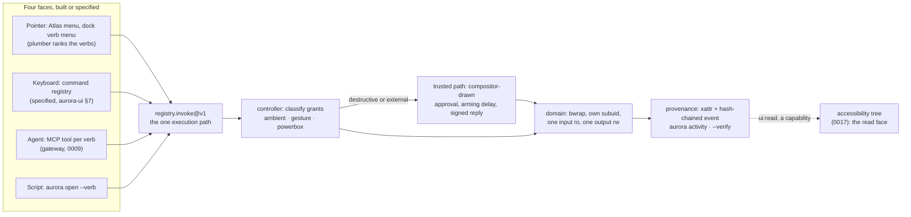
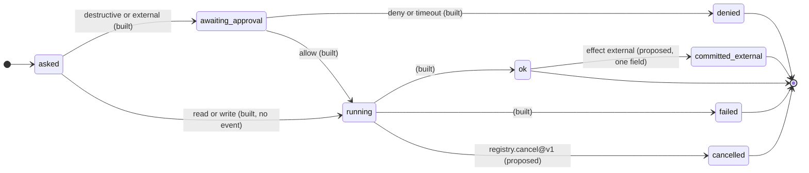

# Future directions: the agency and rendering research, read against what Aurora already is

Status: research note, 2026-11-07. Written from two bibliographies produced by another model
and pasted in by the user, one on rendering architecture and one proposing *agency* as the
organising principle for a desktop with agents in it. Nothing in them was taken on trust: every
citation was checked against a primary record and graded (section 8), and every "toolkit
implication" in them is marked as the paste's proposal, not as a finding. The question this
document answers is not "is the research good" but **"where is Aurora already past it, where
does it name something Aurora lacks, and what would each gap cost"**.

Companion documents: `docs/aurora-ui-framework.md` section 7 and `docs/visual-system.md`
section 12 hold the project's existing references; this document cross-references them rather
than repeating them. `docs/performance-architecture.md` is where the rendering half of the paste
mostly lands, and `contracts/decisions/0007`, `0009`, `0011`, `0017`, `0018`, `0019`, `0020`,
`0022` and `0023` are where the agency half mostly lands. `docs/toy-desktop-os-plan.md` Phase 10
and its "Later" table are the plan this document amends.

How to read it: section 0 is the two reframings and a verdict on the paste's organising
principle. Section 1 fixes the three registers the rest keeps apart. Section 2 is the map of the
paste's vocabulary onto Aurora's mechanisms, which the paste could not see. Section 3 assesses
each candidate gap. Section 4 re-costs the paste's proposed vertical slice against what exists.
Section 5 is what to refuse. Section 6 is the order. Section 7 is where this is most likely
wrong. Costs are in days of one implementer plus what the item blocks, which is the only honest
unit for a project of one person and a set of agents.

---

## 0. Summary

Two reframings, and then the verdict the user asked for.

**First: Aurora is not a desktop with an agent attached, and the paste's destination is Aurora's
starting point.** Block B argues for a world in which operations are a declared set rather than
code buried in applications, a tool has a graphical face, a keyboard invocation and an
agent-callable operation without being three implementations, authorisation comes from a
meaningful gesture rather than a blanket permission, every modality obeys the same authority
checks, a trusted system surface confirms sensitive delegation, and history is inspectable. Every
one of those is built here, under other names: verbs in manifests (0002), the plumber and the
gateway generating tools from the same manifests (0009), powerbox tickets and drop-as-grant (0007,
0011, 0020), `registry.invoke@v1` as the one execution path (0009, 0013), the compositor-drawn
approval with an arming delay and exclusion from captures (0003 amendment, 0007), and the
hash-chained provenance log. Section 2 lays the mapping out. The consequence for reading the
paste is that it is not a feature list; it is a review of **three lifecycles Aurora leaves
short**: the selection's (one file in, one file out, where the paste wants "these 12 images"),
the action's (two states, approve or deny, where the paste wants proposed, running, completed,
failed, stopped and externally committed), and the result's (an output file, where the paste
wants a reusable instrument). Those three are the agency work. Everything else in Block B is
already decided here, usually more strictly than the paste asks.

**Second: the rendering research lands on the compositor, and there mostly on things already
specified under other names.** Block A's "effect dependency graph" (which backdrop each effect
reads, how far its footprint extends, what invalidates it) is `docs/performance-architecture.md`
section 3.2 to the word: `rect ⊕ support(radius, passes, kind)`, a generation ring, a rectangle
intersection. Its "quality tiers" are the fallback ladder (3.4). Its "temporal test suite" is
criterion C5 plus `--freeze-time`, with the static-frame power behaviour being the
render-on-demand item on the roadmap. The one genuinely new item from Block A is a *written*
compositing contract for client buffers, alpha convention included, and that is a page in the
visual system, not a project. The GPU vector renderer track, which is most of Block A by page
count, is the thing to decline: `aurora::ui` is a CPU rasteriser by a measured decision with a
stated reversal condition (performance architecture 5.1), the compositor draws rounded rectangles
from one analytic SDF, and the one place a general path model is needed, `icon.rasterise@v1`,
runs in a domain and may link whatever it likes. The plan's "Later" table still carries a row
for "a native toolkit on Vello-style GPU vector rendering"; performance architecture 5.1 is the
later and measured word, and this document says so rather than leaving the two to disagree
quietly.

**The verdict on agency as the spine.** It is the right description of what Aurora *is*, and
more right than the paste knows. It is the wrong spine for the *next* stretch of work, for three
reasons. The standing goal is a daily driver judged on feel, and agency work is platform work
whose stages produce no visible difference to judge. The largest agency gaps, snapshot
transactions and agent domains, were already in the plan's Phase 10 and are gated on decisions
rather than code (the ticket key the picker cannot read, a distinct controller uid). And the
cheap agency items fall out of Atlas stages that are already scheduled: multi-selection is the
moment to make the grant take a set, the key map is the moment to build the command registry.
So: **adopt the paste's vocabulary, especially the action-state vocabulary and the rule that
cancelling is not undoing, in the records and the activity view now; schedule the three
lifecycles as the work they are; and decline the reorganisation.** The framing was offered as
promising. It is, as a way of naming what has been built. It should not displace the feel work
that the goal is measured by.

---

## 1. Three registers, kept apart

Every entry below says which of three things it is, because the paste is careful about this and
a document that blurred them would be worth less than the paste.

- **Established.** What a paper demonstrates, in its own terms and at its own scope. A CHI
  study of chart transitions established something about chart transitions. Marked with the
  reference tag and the grade from section 8.
- **Proposed.** What the paste deduced as a toolkit implication. The paste labels these
  "toolkit implication (proposed, not from the paper)" and this document keeps the label. A
  proposal is not weaker for being a deduction; it is a different kind of claim.
- **Concluded.** What this document concludes for Aurora, with the mechanism it rests on and
  the cost. Only this register carries a recommendation.

Where a paper's record could not be reached, the entry says so and the idea is judged on its
own merits. A wrong DOI does not make Porter-Duff fictional; it does make the entry unverified.

---

## 2. What Aurora already is, in the paste's words

The paste's own closing claim is that "the opportunity is not merely a desktop with an agent
attached" but "an environment where users can progressively turn intentions into understandable,
reusable instruments". The table maps each concept the paste proposes onto the mechanism Aurora
has, where it lives, and what is honestly not there. The last column is the part worth reading.

| paste concept | Aurora mechanism | where | what is not there |
|---|---|---|---|
| Operations are a declared, enumerable set | Every action is a `[[verb]]` in a manifest with `effect`, `accepts`, input and output schemas; the registry serves them (`registry.verbs@v1`, `describe@v1`) | 0002; `contracts/manifest` | Recipes (chains of verbs) are 0002 open question 2, unanswered |
| One tool, three faces, one implementation | The gateway generates one MCP tool per verb from the same manifests; Atlas's menu and the dock's verb menu are the plumber's ranking of the same verbs; `aurora open --verb` is the script face. All four send `registry.invoke@v1` | 0009; `gateway/`; `contracts/plumb`; 0011 | The keyboard face: the command registry of `docs/aurora-ui.md` section 7 is specified and not built |
| A selection is a platform object | `registry.plumb@v1` takes a selection (path, MIME or text) and ranks verbs; a drop is a grant (0020); the shelf is specified | `contracts/plumb`; 0020; `aurora-ui.md` sections 4, 8 | The controller grants **one regular file in and one out** (`invoke.go`); `Selection` as a value is not built; a multi-selection cannot be the unit of a grant |
| Authorisation through meaningful interaction | Every grant is classified `ambient`, `gesture` or `powerbox` and the class is recorded in provenance; a powerbox ticket is a single-use HMAC over path, mode, app and verb, minted by a pick; a drop mints the same class | 0007, 0011 amendment, 0020 | A ticket proves key possession, not a human; the key is a 0600 file any same-uid process reads. 0007 and 0011 say this in terms. The folder kind exists in the picker and nothing consumes it |
| "Read these 12 images and create derivatives in this folder" | Input grants `ro`, output directory `rw`, per invoke, revoked on exit, as bind mounts into a bubblewrap domain with its own subordinate uid | 0007; `adapter/linux` | The "12": see the selection row. Also 0019: a bind mount cannot be revoked from a holder with an open fd; only mediated (tier 1) and FUSE-backed (tier 2) grants are leases |
| All modalities obey the same authority checks; the semantic API is not a bypass | The gateway starts no process, makes no grant and writes no provenance; it is a client of the controller like the launcher. 0009 is *stricter* for agents: a destructive or external verb always reaches a person, even on ambient grants. Reading a UI's semantic tree is itself a capability, `ui:read`, a bus handle checked against busd's table | 0009, 0017 | Agent identity is a claim (`authenticated:false`); agent domains do not exist; the gateway is advisory against a same-uid process |
| Trusted OS interaction confirms sensitive delegation | The approval prompt is drawn by the compositor above all clients, excluded from client captures, with a 400 ms arming window and a queue cap, signed in reply; the verb, grants and args shown are the controller's | 0003 amendment, 0007, 0011 amendment | The signature covers the decision, not what was drawn; no secure attention key; a client look-alike is not prevented |
| Inspectable actions; history distinguishes local from externally committed | The chronicle: append-only, hash-chained, replayed with invariants; `aurora activity`; `controller provenance --verify`; the effect class `external` names exactly "externally committed" | `bus/`; `controller/`; 0002 | The activity view does not *say* which entries are reversible; cancel does not exist for a running invoke; see 3.2 and 3.3 |
| Pixels describe appearance, metadata describes objects, capability checks decide authority (the paste's reading of MIRAGE [GUO-2026]) | The accessibility tree is what the app_server was sent, served by the app on the bus under `ui:read`; roles are inferred and carry `role_confidence` and `role_basis`; every string is `clean()`ed; authority is never derived from the tree | 0017 | No MCP tool reads the tree yet; roles are mostly `control` or `unknown` |
| Local-first: "where does this live?" has an answer | Files are files; provenance is an xattr plus a log event; a domain's data is `/domain/data`; snapshots are btrfs subvolumes in the adapter | README; `adapter/linux/internal/dom/btrfs.go` | Nothing shows the user a domain's data directory; no sync (plan "Later", Sync Kit) |
| Quiet chrome, expressive content | "The chrome is quiet so the content is loud"; the visual system's refusals (no blur as wallpaper, no animated glass, no depth theatre) | `atlas-design.md` section 1; `visual-system.md` section 1 | Nothing missing against the paste; the paste's own proposed aim is Aurora's stated position |
| Interruption, retargeting, velocity hand-off | Springs as `(duration, bounce)`, `Ease` resuming from the current value on reversal, the switcher as the forcing case | `visual-system.md` 5.2; `shell/motion.rs`; `ui.h` | Coordinated multi-surface transitions: 3.7 |

<figure class="wide">

<figcaption>Section 2. The paste's "one tool, three faces, one implementation" is this diagram, and the paste could not see it. The dashed edge is the fourth face: reading a UI's semantics is itself a grant, so the semantic path is not a bypass. The two things the diagram cannot show are the gaps of section 3: the domain's single input, and the absence of any state between "asked" and "done".</figcaption>
</figure>

Two things in the table deserve emphasis because they are where Aurora is *stricter* than the
paste, not merely level with it.

The paste's security section wants "security enforced outside the model's interpretation" and
warns that "an agent-readable tree is not inherently trustworthy either". Aurora's answer is
structural: the gateway holds no authority at all. It cannot approve, cannot grant, cannot mint;
it relays a verb to the same controller the launcher uses, and the controller's checks are the
same ones a person's click goes through. 0009 then adds a rule the paste does not ask for: an
agent's destructive call reaches a human even when the app's manifest declared the path, because
"the user consented to the app holding that path; they did not consent to an agent deciding what
to do inside it". That is the paste's "a semantic API must not become a privileged bypass",
built, with the bypass closed in the other direction too.

The paste's Webstrates entry carries a security qualification: "borrow the computational-media
model, do NOT assume shared executable content is safe. Code, content and authority need distinct
boundaries." Aurora's Atlas specification already draws that line harder than the paste: "There
is no in-process plugin: no shared object is loaded, no script is interpreted, no decoder is
linked" (section 9), and what an extension cannot do (9.5) includes drawing into the window,
adding a shortcut, or reordering the menu, because "an extension model that lets a third party
redraw the file manager is how a file manager stops being trustworthy". Section 3.5 returns to
what that leaves of malleability.

---

## 3. What the research names that Aurora lacks

Eight candidates: the six this document was asked to judge, two of which were wrong in part
and are corrected below, and two more it adds. Each entry keeps the three registers apart and
ends in a cost.

### 3.1 The selection is not yet the unit of the grant

**Established.** Beaudouin-Lafon's instrumental interaction model [BEAUDOUIN-LAFON-2000]
describes interfaces as domain objects acted on through *instruments*, with the instrument
mediating between the user's action and the object; it is a design model with evaluation
criteria (degree of indirection, integration, compatibility), not an empirical result.
Section 8 gives the grade.

**Proposed.** The paste: "A selection is a platform object, not private application state";
"selecting files supplies a bounded input set; choosing a destination supplies a bounded output
target"; "'Read these 12 images and create derivatives in this folder' is a better conceptual
unit than 'allow this agent to access your files'".

**What Aurora has.** The second half of the sentence, exactly: a grant is a bounded input and
a bounded output, classified by how the user supplied it, revoked when the verb ends. The
plumber already treats a selection as the thing verbs are ranked over. What it does not have is
the "12". `registry.invoke@v1` takes `input` as one string and refuses anything that is not a
regular file (`controller/internal/invoke/invoke.go`); provenance records `Inputs: []string{input}`,
a list of one. 0007 notes that the picker's folder kind "exists in the picker but the controller
grants only single regular files, so no folder ticket is consumed yet". The toolkit's `Selection`
value is specified (`aurora-ui.md` section 4) and not built: selection is a single index per
view. Atlas does multi-select; its context menu cannot yet act on more than one row.

**Concluded.** This is the gap, and it is the one that unlocks the others: the shelf has no
reason to exist until a set can be handed over, the Phase 10 exit demo ("resize the photos in
this folder") needs it, and the paste's whole instrument idea presupposes it. It is not an
instrument concept the platform lacks; it is a cardinality the controller lacks. The design is
already implied by what exists: `inputs[]` beside `input`, one `ro` grant and one ticket per
path, `accepts` gaining a cardinality (`one`, `many`), provenance's `Inputs` already a list, the
verifier recomputing over the list. A verb that accepts many still gets one output or one output
directory; that asymmetry is right, because the output directory grant is already "as wide as the
directory" (0007) and a per-file output list would double the ticket flow for no new authority.

**Cost.** Controller and manifest: 4 to 6 days (the request shape, grants and tickets per path,
the bwrap binds, provenance and `--verify`, the gateway's schema for `inputs`). Toolkit
`Selection` struct and Atlas acting on it: 2 to 3 days, and it belongs in Atlas stage 4 where the
key map and multi-select behaviour are already scheduled. The shelf, after both: 3 days. Blocks:
batch verbs of any kind, the shelf, the Phase 10 exit demo, and every "N files" sentence in the
paste.

### 3.2 Delegation has two states and needs six

**Established.** Horvitz's mixed-initiative principles [HORVITZ-1999] are a set of design
principles argued from decision theory and a worked system (LookOut), among them: consider
uncertainty about goals, weigh the cost of interruption, allow efficient direct invocation and
termination, minimise the cost of poor guesses, and allow refinement of automated results.
Amershi et al. [AMERSHI-2019] is a set of 18 guidelines, validated per the abstract through
iterative rounds including a study with 49 design practitioners against 20 AI-infused
products; it is a design instrument, not a measurement of any one interface.

**Proposed.** The paste: "Delegation is an adjustable interaction state, not a binary agent
mode. Stopping an agent is a normal operation. The interface distinguishes proposed, running,
completed, failed and externally committed work. The user can take over partway through."
Standard components: "an action preview showing affected objects; a scope display showing
accessible resources; pause/cancel with explicit semantics; a structured result with changes
and failures".

**What Aurora has.** More than "approve or deny", but not by much. An invoke is `asked`, then
(for a gated verb) `awaiting_approval` with a request id, then `denied`, `approval_timeout` or
`ok`; the gateway's `aurora_result` reports exactly those. The approval request already carries
"the app, its domain identity, the verb, the effect class, every grant (path, mode, source) and
the arguments" (0007), which *is* the paste's scope display and most of its action preview: the
prompt shows what will be touched, because the grants are the only things that can be touched.
What it does not show is the *effect* ("this will delete 340 files"), which the plan's "Later"
table already names under Capability shell. Running is a state the controller holds (the invoke
blocks with a deadline) but nothing outside it can see or end: `registry.stop@v1` ends launched
windows, not running verbs, and the controller's internal context cancellation (which
`approval.go` already records as "the invoke was canceled while waiting") is not exposed as a
verb. The chronicle records the decision route (`interactive`, `auto-approve`, `ambient`,
`compositor`) but not whether the effect was local or external, except as the verb's effect
class, which the activity view does not surface as "reversible or not". "Take over partway" has
no meaning for a verb, which is atomic by design; it would have meaning for a recipe (3.4).

**Concluded.** Adopt the vocabulary first and the mechanism second, because the vocabulary is
nearly free and makes the mechanism's absence visible. The states, with what each needs:

| state | today | what it takes |
|---|---|---|
| proposed | the approval request, for gated verbs only | nothing new for scope; an effect preview needs a per-verb dry run or a controller-derived count over the grants (3 to 5 days for the grant-derived form: "N files under this directory grant") |
| running | held inside the controller | an `invoke.started` event with the domain name, so activity and the Deskbar can show it (1 day) |
| stopped | does not exist | `registry.cancel@v1 {request_id}`: kill the domain's cgroup, discard the output file, record `cancelled` with elapsed time (2 to 3 days). Only the session user may call it, as with `stop` |
| completed / failed | `ok` and the error vocabulary | already there |
| externally committed | implied by `effect = external` | one field on the record and one word in the activity line: `committed: external` (1 day) |

The diagram shows the lifecycle with the additions marked. Nothing in it needs a new trust
boundary; every addition is a record field or a verb the session user may call.

<figure>

<figcaption>Section 3.2. What an invoke can be today, and the three additions. "running" is built but no event announces it, so nothing outside the controller can show it or end it. "cancelled" is the one new verb; "committed_external" is the one new fact, and it is the fact that section 3.3 says the interface must never blur.</figcaption>
</figure>

The snapshot transaction the plan promises ("the agent works in a copy-on-write snapshot; the
user reviews a diff and commits or discards") is the mechanism behind "proposed" for write
verbs, and it is the large item: the adapter already makes btrfs subvolume snapshots, so the
work is the diff view (an Atlas window whose rows are the changed files, with the provenance
column the plan already wants), the `commit` and `discard` verbs, and a loud refusal on a
non-btrfs data directory rather than an overlay scheme. 2 to 3 weeks. It is Phase 10 work and
should stay there; it is listed here so that the cheap states above are not mistaken for it.

**Cost.** Vocabulary and events: 2 to 3 days. `registry.cancel@v1`: 2 to 3 days. Grant-derived
effect preview: 3 to 5 days. Snapshot transactions: 2 to 3 weeks, Phase 10. Blocks: nothing
before it; the gateway's `aurora_result` and `aurora activity` gain honesty immediately.

### 3.3 Cancelling is not undoing, and the interface says so once

**Established.** Amershi et al.'s guidelines include supporting efficient dismissal and
correction and making clear why the system did what it did [AMERSHI-2019]; the specific
sentence "cancelling computation is not undoing an external action" is the paste's distinction,
not a guideline's text.

**Proposed.** The paste: "The interface must never imply otherwise."

**What Aurora has.** The candidate list said "nothing in the interface says so". That is wrong
in one place and right everywhere else. `docs/atlas-design.md` 8.2 specifies, for moving 50,000
items to the trash, "`Esc` cancelling after the current item; what was moved stays moved". That
is the right sentence, and it is said once, for one operation, in a design document. No record
field, no activity line, no prompt wording carries it.

**Concluded.** Make the distinction a property of the record and then of every surface that
reads the record, because Aurora's architecture makes it *exact* rather than fuzzy, which is
better than most systems can claim:

- A `read` verb: cancel is free; nothing to undo.
- A `write` verb with one output file: cancel discards the output file, so cancel *is* clean.
  The controller already leaves no output on deny; cancel mid-run must do the same and say so.
- A `write` verb with an output directory grant: other files in the directory may have been
  written; cancel is not clean, and the record should list what the domain wrote (the
  provenance index already knows every file an invoke produced).
- A `destructive` verb: there is no undo by construction unless it ran inside a snapshot.
- An `external` verb: the effect is outside the machine. Cancel after the fact is meaningless.
  The approval prompt for an `external` verb should carry one fixed line, "Aurora cannot undo
  this", in the compositor's wording, because the prompt is the one surface a client cannot
  forge.

This should land *before* snapshot transactions, not after, because the snapshot will make some
writes undoable and the interface must already have the vocabulary to say which.

**Cost.** 1 to 2 days: the `committed` field, the activity wording, the prompt line, the
trash wording of Atlas 8.2 carried into the status bar. Blocks: nothing. It is the cheapest
honest change in this document.

### 3.4 Instruments and recipes: the continuum between using and programming, scoped to what a capability system can allow

**Established.** Webstrates [KLOKMOSE-2015] demonstrates a substrate in which a web page's DOM
is persisted and synchronised so that documents and applications are the same kind of object,
with malleability, shareability and distributability as the claimed properties; Codestrates
[RADLE-2017] builds literate computing on it; MyWebstrates [KLOKMOSE-2024] reworks
it as local-first. DynaVis [VAITHILINGAM-2024] shows a system that synthesises UI widgets from a
natural-language editing request so the user can refine by direct manipulation; 24
participants preferred it to a natural-language-only interface, citing ease of further edits
and confidence from immediate visual feedback. The CHI 2025 generative and malleable UI paper
[CAO-2025] proposes an evolving task-driven data model under generated UI, with a technical
and a user evaluation whose sizes the abstract does not give. Section 8 has the grades.

**Proposed.** The paste: "a continuum between using and programming: perform an operation,
inspect its parameters, save it as a reusable command, expose selected parameters as controls,
inspect or edit its implementation"; "the agent helps create a durable instrument the user can
then operate WITHOUT the agent"; from DynaVis, "the natural-language request gets you to a
control surface; direct manipulation handles refinement".

**What Aurora has.** The first two steps of the continuum, and a decided refusal of the last.
Perform an operation: a verb. Inspect its parameters: the approval prompt and the provenance
record carry the exact arguments, and the chronicle has every invoke ever made with its args.
Save it as a reusable command: no. Expose parameters as controls: no, and 0002 open question 1
("how the launcher collects many typed parameters without becoming a form") is the same
question from the other side. Inspect or edit the implementation: refused for third-party code
(Atlas 9.5), and rightly, but a *recipe* is not code.

**Concluded.** The instrument Aurora should have is the **recipe**: a saved list of verb calls
with parameter bindings, as data, run step by step through `registry.invoke@v1` so that every
step gets its own grant, its own approval if gated, and its own provenance line. That is 0002's
open question 2 answered in the paste's terms, and it is the honest form of Codestrates'
continuum for a system whose trust story forbids interpreted content: the recipe can be
inspected, edited and shared because it contains no code, only verbs the system already
enumerates and arguments the manifests already type. Three things follow and each is a separate
piece of work:

1. **Save what I just did.** The chronicle already holds it. A `recipe.save` over a range of
   invokes writes the TOML; the arguments that were paths become parameters. 3 days.
2. **A parameter form generated from the input schema.** `aurora::ui` has the controls
   (`TextField`, `Button`, the slider and switch in the specimen); a `Form(schema)` node that
   lays them out by type is the launcher's open question 1 and DynaVis's "controls, not an
   answer". 5 to 8 days.
3. **The agent produces a recipe, not a transcript.** The gateway gains one tool,
   `aurora_recipe_propose`, whose result is a recipe the user opens in the form. The agent never
   runs it; the user does, with the same approvals. 2 to 3 days after 1 and 2.

What "take over partway" means in Aurora is now definable: a recipe stopped after step k leaves
steps 1..k in provenance, and the user runs k+1 by hand or edits it. That is Horvitz's
"efficient termination" with a precise meaning.

**Cost.** Format and runner 5 to 7 days; the three pieces above 10 to 14 days; about three weeks
in all, after 3.1. Blocks: it closes 0002 open questions 1 and 2, and it is the thing that makes
the gateway's output durable.

### 3.5 Malleability: accept the data form, decline the executable form

**Established.** As 3.4.

**Proposed.** The paste: "users can duplicate and adapt a tool rather than configure a fixed
application; different people can use different interfaces to the same content; a useful
arrangement of tools can become a reusable artifact", with the paste's own qualification that
shared executable content is not to be assumed safe.

**What Aurora has.** Malleability as data, in several places that are not called that: the
theme file hot-reloads; places, columns and kinds are manifest entries (Atlas 9.3, 9.4); saved
queries are files; recipes (3.4) would be files. Malleability as code: refused by Atlas 9.5,
0023 ("not a new UI framework"), and the preview rule that the app never decodes a file.

**Concluded.** Decline the Webstrates form. The reason is not caution; it is that Aurora's
trust claim ("trust is the product here", Atlas 9.5) depends on the user's own tools being
unforgeable by the content they show, and a workspace in which content and computation are the
same object is precisely the thing that claim refuses. "A useful arrangement of tools can
become a reusable artifact" is accepted as a recipe plus a saved window layout (the compositor
already persists placement across a crash); "different interfaces to the same content" is
already what the four faces are. No further work; the refusal is the decision.

**Cost.** None, and that is the point.

### 3.6 The compositor's rendering model: what Block A asks for, and how much is specified already

**Established.** Porter and Duff [PORTER-DUFF-1984] define the alpha channel and the
compositing algebra. Ganacim et al. [GANACIM-2014], Li, Hou and Zhou [LI-2016], Dokter et al.
[DOKTER-2019] and Loop and Blinn [LOOP-BLINN-2005] are GPU vector rendering architectures;
the Vello sparse-strips issue [VELLO-670] is a tracking issue, not a design document or a
paper, and the design it tracks has since shipped as `vello_cpu` and `vello_gpu`, of which
the project's own README says the CPU renderer "is currently overall more mature". Nehab et
al. [NEHAB-2011] reorganise recursive filters for memory traffic. Wolfe et al. [WOLFE-STBN]
construct noise masks with good spatial and temporal spectra. Green
[GREEN-2007] and Chlumský et al. [CHLUMSKY-2017] are the distance-field texture papers; Rong
and Tan [RONG-TAN-2006] is the jump-flooding distance transform. Grades in section 8.

**Proposed.** The paste's six "architectural consequences": a compositing contract, unified
geometry, an effect dependency graph, motion transactions, quality tiers, a temporal test
suite; and "treat general vector rendering as an architectural subsystem rather than unrelated
special-case fragment shaders".

**What Aurora has, item by item.**

| consequence | status | where |
|---|---|---|
| Compositing contract: alpha, group isolation, masks, working space | partly written: the blur runs in linear light with the arithmetic shown; 10-bit with a gamma-2.0 store; premultiplied source-over named for the fixed-function blender; the client never receives backdrop pixels | `visual-system.md` 2.1 to 2.4; 0023 |
| Unified geometry: one path model for fills, clips, hit testing, effects | not present, and not wanted: the compositor's shapes are rectangles and one exact rounded-box SDF, with the analytic shadow sharing it; the toolkit is a CPU rasteriser with fills, strokes, round rects, ellipses, gradients, polygons with holes, and text | `visual-system.md` 3.6, 4; `au_draw.h`; performance architecture 5.1 |
| Effect dependency graph | **specified**, as the recompute rule: a glass surface is a pure function of the scene inside `rect ⊕ support(radius, passes, kind)`, its size and position modulo the chain's downsampling, and the theme; validity is a rectangle test against a generation ring | performance architecture 3.2 |
| Motion transactions | per-property; see 3.7 | `ui.h`; `shell/motion.rs` |
| Quality tiers | **specified**: the four-level fallback ladder with a demotion and promotion rule, each level a theme state with a reference capture | performance architecture 3.4; 0023 |
| Temporal test suite | partly: C5 (sub-pixel translation, the bright pixel), `--freeze-time` making a frozen frame byte-identical, the rule that material noise must not vary with time; static-frame power behaviour is the render-on-demand item | `visual-system.md` 9, 10; roadmap |

**Concluded, in three parts.**

*Write the compositing contract down, in one page.* The pieces exist across two documents and a
decision record and no single place states, for a client buffer arriving over `wl_shm` as
ARGB8888, whether alpha is premultiplied, what the compositor assumes when it imports it, what
happens to an un-premultiplied edge under the blur, and what a client may rely on when it
declares a blur region under `ext-background-effect-v1`. Atlas stage 9's glass sidebar is the
first client that will need the answer. This is the one item from Block A that is new, and it
is a section in `visual-system.md`, not a subsystem. 1 day.

*Decline the GPU vector renderer, for the reasons already recorded, and say which record
wins.* Performance architecture 5.1 chose the CPU rasteriser with a stated reversal condition
("a client whose typical frame needs more than half the frame period of raster at the target
refresh with the caches warm") and the measured reason (an icon grid went from 8.25 ms to under
budget by caching glyphs, not by changing rasterisers; a 1856x1160 fill is 0.11 ms). The
paste's own priority note agrees: "high IF building the renderer rather than delegating it".
Aurora delegates the one general-path workload it has, `icon.rasterise@v1`, to a verb in a
domain, where the provider may use resvg, Skia or Vello and the toolkit links nothing. The
plan's "Later" row for a "native toolkit on Vello-style GPU vector rendering" predates 5.1 and
should be read as superseded by it until 5.1's condition trips. That is a sentence for the plan,
not work. One fact from the verification is worth carrying into that sentence: Vello itself now
ships a sparse-strips renderer on the CPU, `vello_cpu`, and calls it the more mature of its two.
If 5.1's condition ever trips, the step is a better CPU rasteriser with sparse coverage, not a
GPU toolkit, and the headless pixel-identical test idiom survives it.

*Decline the filtering, noise and distance-field items individually, because each answers a
problem Aurora measured itself not to have.* Nehab's bandwidth reorganisation addresses a
bandwidth-bound filter; Aurora's blur is dual-Kawase at about 7% of a separable Gaussian's
bandwidth (`visual-system.md` 3.2) and the measured cost of its frame is 20 GPU round trips at
65 us each, not bandwidth (performance architecture 0.1, 3.1). Spatiotemporal blue noise is for
a renderer that re-draws noise every frame; Aurora's rule is that material noise must not vary
with time and that an idle desktop should produce no frames, and the paste itself says
"temporal sampling quality is NOT a reason to keep an otherwise static desktop repainting".
Jump flooding gives distance to an arbitrary raster silhouette; Aurora's selections are rows and
tiles, and there is no irregular shape to halo until a canvas application exists. Multi-channel
distance fields give one scalable icon asset; Atlas's icons are rasterised per
`(source, size, scale)` by a verb and cached, at 16 to 80 px, and the quality question for small
sizes is exactly the one the paste says MSDF does not settle. Direct curve rasterisation, smooth
vector graphics as a Poisson problem, GPU brush strokes and Bézier splatting are an asset
pipeline for a product Aurora does not have. Each of these becomes relevant the day a drawing
or canvas application is a client, and performance architecture 4.1 already says what such a
client gets: a dmabuf surface of its own, not a GPU toolkit.

**Cost.** The contract page: 1 day. The plan sentence: an hour. Everything else: declined.

### 3.7 Motion: coordinated transitions in the compositor, and identity preservation where the specification allows it

**Established.** Lasseter [LASSETER-1987] is a craft statement of the Disney principles
applied to computer animation; it is not a study. Heer and Robertson [HEER-ROBERTSON-2007]
give a taxonomy of transitions in statistical graphics and report two controlled experiments
with the same 24 subjects: animation beat static transitions on object tracking in every
condition, staged animation beat plain animation in most, and on value-change estimation
animation beat static for scatter plots and grouped bars but not stacked bars; the subjects
preferred staged animation. The result is about charts being watched. The CGF 2020 survey
[THOMPSON-2020] characterises the design space and authoring paradigms of animated data
graphics and finds designers preferred keyframing but wanted all three paradigms. Narrative
Motion Blocks [BOURGAULT-2025] is an authoring system (AniMate, DIS 2025) with an
intermediate representation shared between text and manual editing. Dragicevic et al.,
already in the visual system as [DRAGICEVIC-2011], is the one empirical result on easing the
project cites, and it is for object tracking.

**Proposed.** The paste: "represent coordinated transitions, not only independent property
tweens; sequencing and overlapping motion without applications maintaining many timers";
"preserve object identity across changes; stage complex transformations when simultaneous
changes obscure correspondence"; "several motion mechanisms over one coherent state model";
"agent-authored behaviour should become an editable artifact with visible structure".

**What Aurora has.** Motion as a table of named tokens, each a duration and a curve, resolved
in one place with the two switches that turn it down; an `Ease` that resumes from the current
value on reversal; springs specified as `(duration, bounce)` with the switcher as the case that
forces them; a gate that degrades motion to none under budget, with the degradation counted. And
two refusals, both measured: "Only two things may animate: a thing appearing or disappearing,
and a container changing size. Content position never animates" (`aurora-ui.md` section 1), and
no per-item animation, because "a list of forty rows each on its own curve is forty invalidations
a frame, and the measured budget has 8 ms for the whole handler". The candidate list said motion
has "no identity preservation across a list reordering". That is true, and it is a decision,
not an omission: the Atlas specification's reason is that "an animation that moves a row the
person is reaching for" is one of the things the design rejects, and the latency research in
the framework document is the evidence behind it.

**Concluded.** Split the paste's motion item in two, because the two halves land on different
processes with different budgets.

*In the toolkit: decline identity-preserving list transitions, and keep the refusal written.*
Heer and Robertson's result is about following a datum through a chart transformation the user
is watching; a file list the user is operating is a different task, and the house rule that
nothing moves under the pointer is the right one for it. The sort-as-snapshot rule (Atlas 5.4)
and the dimmed previous listing (Atlas 8.2) are the staging the paste asks for, done without
movement. Nothing to build.

*In the compositor: build transition groups, because the daily-driver goal names exactly the
cases.* "Elements appearing and disappearing from the dock, windows opening and closing" are
multi-surface transitions: a window closing dims its glass, moves its Deskbar row, and shifts
the dock's neighbours, and today each is its own `Ease` on its own clock. A **transition group**
is one clock, one curve or spring, several surfaces, interruptible as a unit, which is Lasseter's
staging and overlapping action reduced to the one mechanism the switcher already improvises. It
is also where Heer and Robertson's identity rule does apply: a window that becomes a dock item
should visibly go to the dock item, because that is "where did it go" for a surface the user
was not reaching for. The Flip 3D switcher and the window-close animation are the existing code
to generalise.

*The "editable artifact with visible structure" is the motion table.* Durations and curves are
already values in one table that will move to `[theme.ui.motion]`; the paste's Narrative Motion
Blocks idea, applied here, is that a transition group is a named row in that table too, so that
tuning window-close is editing a value, which is the Atlas specification's stated intent ("the
exploration the user wants is setting a number here and judging it").

**Cost.** Transition groups in the compositor: 5 to 7 days, in the daily-driver track rather
than the agency track. Blocks: the dock and window motion the goal names; nothing in the agency
work.

### 3.8 Two small gaps the paste points at indirectly

**"Where does this live?" for a domain's data.** Local-first software [KLEPPMANN-2019] argues
that ownership should be legible: storage, export, history and sharing behaviour the user can
understand. Aurora's answer is good for files the user made (a path, an xattr, a verifiable
chain) and silent for the one place it invented: a windowed app's `HOME` is `/domain/data`, and
nothing shows the user where that is on the host or what is in it. The Deskbar row for a domain
is the natural place for one line and an "open in Atlas" action. 1 to 2 days, and it closes
0022's finding that Files "is useless in a domain" from the other side, by making the domain's
own data reachable.

**Showing the ticket's limit.** The paste's Polaris entry [DEWITT-KULJIS-2006] wants
"expanding scope is a visible event". What the study itself found, in ten participants, is
less comfortable: people knowingly compromised security to finish faster and were apathetic
about decisions they were asked to make, which is an argument for authority that follows from
the gesture rather than for more prompts, and that is the side Aurora is on. The capability
indicator (0016) already lights while a grant is held and names the domain. What the paste's
framing adds is that a grant whose source
was `gesture` rather than `powerbox` (a path a caller merely asked for, with no ticket) is a
scope the user did not expand, and the indicator does not distinguish it. One colour or one
word in the indicator row for `source: gesture`. 1 day, and it is the indicator's own
"what is not shown" list extended by the fact 0007 already records.

---

## 4. The paste's vertical slice, re-costed

Block B proposes prototyping one slice before adding effects: a workspace of documents, images,
notes and an agent, with nine capabilities. Against Aurora most of it exists, which is the
strongest evidence for section 0's first reframing. Costs refer to section 3.

| step | the paste asks for | Aurora today | missing | cost |
|---|---|---|---|---|
| 1 | Select a bounded set of objects | Atlas multi-select; the chooser; drop as grant | the set as the unit of a grant (3.1) | 7 to 9 days |
| 2 | Invoke an instrument by gesture, keyboard or text | pointer via plumber; agent via gateway; script via `aurora open` | the command registry (`aurora-ui.md` 7) | 5 days, Atlas stage 4 |
| 3 | Inspect a proposed transformation | the approval prompt: verb, args, every grant with its source | the *effect* preview (3.2) | 3 to 5 days; snapshot diff is Phase 10 |
| 4 | Adjust it through concrete controls | no | the schema-generated form (3.4) | 5 to 8 days |
| 5 | Delegate execution with explicit scope | yes: grants are the scope; the gateway's roots are the agent's | agent domains for an attested identity | Phase 10 |
| 6 | See incremental results without losing spatial context | live queries (`aurora query run --watch`); Atlas 8.7 changes under the window | nothing for the slice | 0 |
| 7 | Stop execution and inspect what already happened | activity and provenance exist; stop does not | `registry.cancel@v1` and the running event (3.2) | 3 to 4 days |
| 8 | Save the successful workflow as a reusable tool | no | recipes (3.4) | about 3 weeks |
| 9 | Reopen and use the workspace without the agent or network | yes by construction: domains have an empty network namespace; nothing is remote | nothing | 0 |

About seven to nine weeks of one implementer for the whole slice short of Phase 10's snapshot
and agent-domain items (step 4's form is inside step 8's recipe cost, so the two are not
added twice), with 3.1 and 3.3 first because everything else assumes them. The paste's
own sentence about visual treatment ("selection shows scope; motion preserves identity; material
distinguishes transient tools from persistent content; trusted chrome identifies authorisation;
history distinguishes local edits from externally committed actions") is, read against the
table, four things Aurora does and one it should (3.3).

---

## 5. What this document declines, with the reason

A reading list that recommends everything is useless. Each refusal names the mechanism it rests
on, so that a later reader can see whether the mechanism changed.

| declined | reason | would change if |
|---|---|---|
| A GPU vector renderer for the toolkit (Ganacim, Li, Dokter, Loop-Blinn, Vello sparse strips) | performance architecture 5.1: the CPU rasteriser is cheaper in every dimension for a UI that changes a few percent of a window per frame, and the headless pixel-identical test idiom depends on it | 5.1's condition: a typical frame over half the frame period with the caches warm |
| A unified path model across fills, clips, hit testing and effects | the compositor has one shape (the rounded box) and rectangles; the toolkit has no clip paths; there is nothing to unify | a canvas or drawing client, which gets a dmabuf surface, not a toolkit change |
| Bandwidth-oriented recursive filtering (Nehab 2011) | the blur is not bandwidth-bound; the measured cost is round trips (0.1, 3.1), and dual-Kawase is already at 7% of a Gaussian's traffic | the bare-metal integrated GPU measured otherwise (performance architecture 7.4) |
| Spatiotemporal blue noise | material noise must not vary with time (visual system 9); an idle desktop should produce no frames; the dither is fixed under `--freeze-time` | never, while those rules hold |
| Jump-flooding distance transforms for selection halos | selections are rectangles | an irregular selection shape, which no client has |
| Multi-channel SDF icon atlases | icons are rasterised per size by a verb and cached; small-size quality is the open question MSDF does not answer | an icon workload the cache cannot hold |
| Poisson gradients, GPU brush strokes, Bézier splatting | an asset pipeline for a drawing product | a drawing product |
| Executable malleability (Webstrates' shared computational media) | Atlas 9.5 and 0023: no in-process code, because the trust claim is the product | a decision record that reverses 9.5 |
| Per-item and identity-preserving list animation | `aurora-ui.md` 1 and 9: nothing moves under the pointer; forty invalidations a frame against an 8 ms budget | a different list, not a different budget |
| Retained-mode tree diffing as the "coherent state model" | `aurora-ui-framework.md` 1.2: build once, state cells, diff nothing | nothing; it is the toolkit's spine |
| A chat transcript as the agent's primary surface | the gateway returns handles (request ids, result records) already; 3.4 makes the durable output a recipe | nothing; the paste agrees |
| Screenshots as an authorisation substrate | already refused by construction: authority is a bus handle, the tree is a capability, the prompt is the compositor's | nothing; MIRAGE's finding, as the paste summarises it, argues for exactly the structure 0017 has |
| Reorganising the roadmap around agency | the standing goal is judged on feel; the agency gaps fall out of scheduled Atlas stages and Phase 10 | the goal changing |

---

## 6. Order and cost

The order follows dependency and cheapness, not importance. Items in the agency track are
marked A; items that belong to the daily-driver track and are mentioned because the paste bears
on them are marked D.

| # | item | track | days | depends on | what it unblocks |
|---|---|---|---|---|---|
| 1 | "Cancel is not undo": the `committed` field, activity wording, the fixed prompt line for `external` (3.3) | A | 1 to 2 | nothing | honesty before any snapshot work |
| 2 | Action states as events: `invoke.started`, the state vocabulary in `aurora_result` and activity (3.2) | A | 2 to 3 | nothing | the Deskbar can show a running verb; cancel has something to cancel |
| 3 | The compositing contract page in `visual-system.md` (3.6) | D | 1 | nothing | Atlas stage 9's glass sidebar; the first translucent client |
| 4 | `inputs[]` in the controller, tickets per path, provenance over the list (3.1) | A | 4 to 6 | nothing | every batch verb; the shelf; the Phase 10 exit demo |
| 5 | `Selection` as a value in the toolkit; Atlas's menu acting on a set (3.1) | A/D | 2 to 3 | 4 | the shelf; the command registry's `enabled(selection)` |
| 6 | `registry.cancel@v1` (3.2) | A | 2 to 3 | 2 | the paste's step 7 |
| 7 | The command registry and its four surfaces (`aurora-ui.md` 7) | D | 5 | 5 | the keyboard face; the palette; Atlas stage 4 |
| 8 | Transition groups in the compositor (3.7) | D | 5 to 7 | nothing | the dock and window motion the goal names |
| 9 | Domain data in the Deskbar; `source: gesture` in the indicator (3.8) | A | 2 to 3 | nothing | two legibility gaps |
| 10 | Grant-derived effect preview, "N files under this grant" (3.2) | A | 3 to 5 | 4 | the paste's step 3 short of a snapshot |
| 11 | Recipes: format, runner, save-from-chronicle, the schema form, the agent's propose tool (3.4) | A | 15 to 20 | 4, 5, 7 | 0002 open questions 1 and 2; the paste's steps 4 and 8 |
| 12 | Snapshot transactions with a diff view, btrfs only (3.2) | A, Phase 10 | 10 to 15 | 4, 11 | the plan's Phase 10 exit demo |

Items 1 to 3 are a week and change nothing visible except words, which is why they are first:
they are the paste's contribution at its cheapest. Items 4 to 7 are the selection and command
lifecycles and should ride Atlas stages 4 and 5. Item 8 is the one motion item and belongs to
the feel work. Items 11 and 12 are the two large pieces and should each get a decision record
before they start, because each has a design question this document does not settle (the recipe
format's parameter binding; the diff view's claim about what "discard" restores).

---

## 7. Where this is most likely wrong

- **The cost of `inputs[]` may be hiding in the manifests, not the controller.** Every verb
  that accepts many needs to say what it does with many (one output per input, or one output
  for all), and ImageMagick's and ffmpeg's wrappers decide that per tool. If the manifest schema
  needs a per-verb output policy, item 4 is closer to two weeks.
- **Recipes may want exactly the thing this document refuses.** The moment a recipe needs a
  condition ("if the image is wider than 2000 px") it is a program, and the data-only form
  stops being enough. The honest answer is probably that a recipe is linear and anything else is
  an agent's job at run time; whether users accept that is unknown.
- **Transition groups may belong to the toolkit's refusals.** The compositor's budget is not the
  toolkit's, but the window-close animation already produced a damage defect (the memory file
  on diagnosing before theorising records it); a mechanism that animates several surfaces at once
  multiplies that class of bug. The measurement discipline of performance architecture 8 is the
  mitigation, not an argument against.
- **The verdict on the spine may be too conservative.** If agents become the main way the user
  operates the system, the three lifecycles stop being platform work and become the feel. The
  tell would be the user running recipes more than menus; nothing today suggests that, and the
  goal file says Dolphin and Finder.
- **Several citations are 2025 and 2026 venues**, and one, MIRAGE, is an unrefereed May 2026
  preprint. Every record resolved to the paper claimed (section 8), which is better than this
  document expected of a pasted bibliography; the caveat that remains is that the publishers'
  own pages refused automated reads, so most entries are graded on the registrar's record and
  an author-hosted copy rather than the publisher's text. The conclusions do not rest on any
  result those papers claim; MIRAGE's finding, if it fell, would leave 0017's structure
  exactly as justified as it was before the paper existed.

---

## 8. References

Tagged as cited above. Following `docs/aurora-ui-framework.md` section 7: **verified** means the
primary text was read this session; **abstract** means only the abstract or a bibliographic
record was; **secondary** means a summary or a non-primary page; **in-house** means the citation
is carried from another Aurora document whose author verified it. Where the paste's claim and
the record disagree, the record is given and the discrepancy named. Entries already in
`aurora-ui-framework.md` section 7 or `visual-system.md` section 12 are cross-referenced, not
repeated.

How the checking was done, because it bears on the grades: every DOI was resolved through
doi.org and its publisher-deposited record read from Crossref or DataCite; every arXiv id was
read from its abstract page; full texts were read where an author- or venue-hosted copy
exists. `dl.acm.org`, Wiley, IEEE Xplore, ScienceDirect and `diglib.eg.org` refused automated
reads this session, so no entry's grade rests on a publisher's landing page. The result, stated
once: **all 33 claims resolved to the paper claimed, with the authors and years claimed.** The
corrections below are to venues, missing DOIs, and one mislabelled document type.

**Interaction and delegation**

- [BEAUDOUIN-LAFON-2000] Michel Beaudouin-Lafon, "Instrumental interaction: an interaction
  model for designing post-WIMP user interfaces", CHI 2000, pp. 446-453, DOI
  10.1145/332040.332473. https://www.lri.fr/~mbl/papers/CHI2000/paper.pdf — verified. A
  conceptual model (instruments reify commands; degree of indirection, integration and
  compatibility as evaluation criteria); no user study.
- [KLOKMOSE-2015] Clemens N. Klokmose, James R. Eagan, Siemen Baader, Wendy Mackay, Michel
  Beaudouin-Lafon, "Webstrates: shareable dynamic media", UIST 2015, pp. 280-290, DOI
  10.1145/2807442.2807446 — abstract. Two case studies and three prototypes; a systems paper,
  no controlled study. The paste gave "et al."; the list is as above.
- [RADLE-2017] Roman Rädle, Midas Nouwens, Kristian Antonsen, James R. Eagan, Clemens N.
  Klokmose, "Codestrates: literate computing with Webstrates", UIST 2017, pp. 715-725, DOI
  10.1145/3126594.3126642 — abstract. The paste gave no authors.
- [KLOKMOSE-2024] Clemens Nylandsted Klokmose, James R. Eagan, Peter van Hardenberg,
  "MyWebstrates: Webstrates as local-first software", UIST 2024, DOI
  10.1145/3654777.3676445 — abstract. The paste gave no authors.
- [HORVITZ-1999] Eric Horvitz, "Principles of mixed-initiative user interfaces", CHI 1999,
  pp. 159-166, DOI 10.1145/302979.303030. https://www.erichorvitz.com/chi99horvitz.pdf —
  verified. Twelve "critical factors", illustrated with LookOut; a principles paper with a
  worked system, no experiment. The paste gave no DOI.
- [AMERSHI-2019] Saleema Amershi, Dan Weld, Mihaela Vorvoreanu, Adam Fourney, Besmira Nushi,
  Penny Collisson, Jina Suh, Shamsi Iqbal, Paul N. Bennett, Kori Inkpen, Jaime Teevan, Ruth
  Kikin-Gil, Eric Horvitz, "Guidelines for human-AI interaction", CHI 2019, DOI
  10.1145/3290605.3300233 — abstract. 18 guidelines; validated through iterative rounds
  including 49 practitioners against 20 products, per the abstract. The paste gave "et al."
  and no DOI.
- [VAITHILINGAM-2024] Priyan Vaithilingam, Elena L. Glassman, Jeevana Priya Inala, Chenglong
  Wang, "DynaVis: dynamically synthesized UI widgets for visualization editing", CHI 2024,
  DOI 10.1145/3613904.3642639; preprint arXiv 2401.10880 — abstract. 24 participants preferred
  it to a natural-language-only interface. Not the same DynaVis as [HEER-ROBERTSON-2007]'s
  system, which shares the name.
- [CAO-2025] Yining Cao, Peiling Jiang, Haijun Xia, "Generative and malleable user interfaces
  with generative and evolving task-driven data model", CHI 2025, DOI
  10.1145/3706598.3713285; preprint arXiv 2503.04084 — abstract. The paste gave no authors.
  Evaluation sizes are not in the abstract.

**Security**

- [DEWITT-KULJIS-2006] Alexander J. DeWitt, Jasna Kuljis, "Aligning usability and security:
  a usability study of Polaris", SOUPS 2006, DOI 10.1145/1143120.1143122.
  https://cups.cs.cmu.edu/soups/2006/proceedings/p1-dewitt.pdf — verified. Three pilots and
  ten participants; participants knowingly traded security for speed. The paste's caveat ("not
  evidence every aspect succeeded") understates it: the paper's finding is that usability
  problems remained where decisions were required.
- [GUO-2026] Ruoqi Guo, Yi Liu, Gelei Deng, Yiheng Xiong, Yuekang Li, Ying Zhang, Leo Yu
  Zhang, Lida Zhao, Ji Jie, Yuxiao Lu, "MIRAGE: context-aware prompt injection against mobile
  GUI agents via user-generated content", arXiv 2605.28116, submitted 2026-05-27, v1 —
  abstract. The id the user asked to scrutinise exists and is this paper. Per the abstract: a
  1,111-sample benchmark over ten applications and eleven intents; all five evaluated VLM
  agents vulnerable, attack success 23-30%; realism rated above the strongest prior attack
  (3.02 vs 2.52 of 5); per-sample realism and success uncorrelated. **Unrefereed preprint**;
  no venue on the page. The paste's summary matches the abstract.

**Aesthetics and ownership**

- [LAVIE-TRACTINSKY-2004] Talia Lavie, Noam Tractinsky, "Assessing dimensions of perceived
  visual aesthetics of web sites", IJHCS 60(3), 2004, pp. 269-298, DOI
  10.1016/j.ijhcs.2003.09.002 — abstract (registrar record and the author's page; the
  publisher page refused). Four studies; two five-item scales, classical and expressive.
  Cited in section 2 only to note that Aurora's stated position already matches the paste's
  proposed aim.
- [KLEPPMANN-2019] Martin Kleppmann, Adam Wiggins, Peter van Hardenberg, Mark McGranaghan,
  "Local-first software: you own your data, in spite of the cloud", Onward! 2019 (SPLASH),
  pp. 154-178, DOI 10.1145/3359591.3359737. https://martin.kleppmann.com/papers/local-first.pdf
  — verified (first pages). An essay with seven ideals and prototype findings; no study.

**Compositing and GPU vector rendering**

- [PORTER-DUFF-1984] Thomas Porter, Tom Duff, "Compositing digital images", SIGGRAPH 1984,
  Computer Graphics 18(3), pp. 253-259, DOI 10.1145/800031.808606.
  https://keithp.com/~keithp/porterduff/p253-porter.pdf — verified. Already listed in
  `toy-desktop-os-plan.md` §References, as a bare line with no DOI and nothing drawn from it;
  this is the first use. `visual-system.md` 2.1 to 2.4 state the linear-light and premultiplied
  conventions without citing it, and the contract page of 3.6 should.
- [GANACIM-2014] Francisco Ganacim, Rodolfo S. Lima, Luiz Henrique de Figueiredo, Diego
  Nehab, "Massively-parallel vector graphics", ACM TOG 33(6), 2014 (the SIGGRAPH Asia 2014
  issue), DOI 10.1145/2661229.2661274. https://w3.impa.br/~diego/publications/GanEtAl14.pdf
  — verified (first pages). Declined, section 5.
- [LI-2016] Rui Li, Qiming Hou, Kun Zhou, "Efficient GPU path rendering using scanline
  rasterization", ACM TOG 35(6), 2016, DOI 10.1145/2980179.2982434 — abstract. Boundary
  fragments in parallel, interiors as spans; 2.5x reported at Ultra HD. Declined, section 5;
  it is the paper behind Vello's sparse strips.
- [DOKTER-2019] Mark Dokter, Jozef Hladky, Mathias Parger, Dieter Schmalstieg, Hans-Peter
  Seidel, Markus Steinberger, "Hierarchical rasterization of curved primitives for vector
  graphics rendering on the GPU", Computer Graphics Forum 38(2), 2019 (Eurographics 2019),
  pp. 93-103, DOI 10.1111/cgf.13622 — abstract. The CPatch claim is the abstract's own
  wording. Declined, section 5.
- [LOOP-BLINN-2005] Charles Loop, Jim Blinn, "Resolution independent curve rendering using
  programmable graphics hardware", ACM TOG 24(3), 2005, pp. 1000-1009, DOI
  10.1145/1073204.1073303 — abstract. The paste gave no DOI. Declined, section 5.
- [IGEHY-1998] Homan Igehy, Gordon Stoll, Pat Hanrahan, "The design of a parallel graphics
  interface", SIGGRAPH 1998, pp. 141-150, DOI 10.1145/280814.280837.
  https://graphics.stanford.edu/papers/parallel_api/parallel_api.pdf — verified (first
  page). The paste gave no DOI. Not used above: its lesson (ordering semantics before
  parallel submission) is already the shape of performance architecture 3.1, which keeps GL's
  in-context ordering and submits once.
- [VELLO-670] Raph Levien, "Sparse strip path rendering", linebender/vello issue 670, opened
  2024-08-22, open as of this session. https://github.com/linebender/vello/issues/670 —
  verified (issue and repository read). A **tracking issue**, as its first line says, not a
  design document. The design has shipped: `vello_cpu` (crates.io 0.0.1 2025-05 to 0.3.0
  2026-10) and `vello_gpu` (renamed from `vello_hybrid` in PR 1883, 2026-09-08), with
  `vello_common` shared; `ARCHITECTURE.md` describes paths flattened, binned into tiles and
  represented as sparse horizontal strips. There is no crate named `vello_sparse_strips`.
  Section 3.6 uses the README's own statement that the CPU renderer is the more mature.

**Filtering and noise**

- [NEHAB-2011] Diego Nehab, André Maximo, Rodolfo S. Lima, Hugues Hoppe, "GPU-efficient
  recursive filtering and summed-area tables", SIGGRAPH Asia 2011, DOI
  10.1145/2024156.2024210. https://w3.impa.br/~diego/publications/NehEtAl11.pdf — verified.
  "Read only twice and written just once" is the paper's own wording. Declined, section 5,
  because the blur is not bandwidth-bound; `visual-system.md` 3.2 and [BJORGE-2015] there
  are the in-house comparison.
- [WOLFE-STBN] Alan Wolfe, Nathan Morrical, Tomas Akenine-Möller, Ravi Ramamoorthi, "Scalar
  spatiotemporal blue noise masks", arXiv 2112.09629 (2021); published as "Spatiotemporal
  blue noise masks", EGSR 2022, pp. 117-126, DOI 10.2312/sr.20221161 (DataCite) — abstract.
  Declined, section 5. The in-house blue-noise references are [ULICHNEY-1993] and
  [WOLFE-VAC] in `visual-system.md` 12, which cover the static mask Aurora uses.
- [DONNELLY-2024] William Donnelly, Alan Wolfe, Judith Bütepage, Jon Valdés, "FAST:
  filter-adapted spatio-temporal sampling for real-time rendering", PACMCGIT 7(1), 2024, DOI
  10.1145/3651283; arXiv 2310.15364 — abstract. The paste gave no authors and the preprint
  title. Not used above; the paste itself says to keep it exploratory unless the renderer uses
  stochastic sampling, which Aurora's does not.

**Distance fields**

- [GREEN-2007] Chris Green, "Improved alpha-tested magnification for vector textures and
  special effects", ACM SIGGRAPH 2007 Courses (course 28, "Advanced Real-Time Rendering in
  3D Graphics and Games"), pp. 9-18, DOI 10.1145/1281500.1281665.
  https://cdn.akamai.steamstatic.com/apps/valve/2007/SIGGRAPH2007_AlphaTestedMagnification.pdf
  — verified. A **course-notes chapter**, not a paper, which the paste did not say. The
  in-house SDF references ([IQ-SDF2D], [KWIN-SDF], [LEVIEN-2020] in `visual-system.md` 12)
  cover the analytic case Aurora uses; Green is the texture case, declined.
- [CHLUMSKY-2017] Viktor Chlumský, Jiří Sloup, Ivan Šimeček, "Improved corners with
  multi-channel signed distance fields", Computer Graphics Forum 37(1), pp. 273-287, online
  2017-09, issue 2018, DOI 10.1111/cgf.13265 — abstract. Declined, section 5.
- [RONG-TAN-2006] Guodong Rong, Tiow-Seng Tan, "Jump flooding in GPU with applications to
  Voronoi diagram and distance transform", I3D 2006, pp. 109-116, DOI
  10.1145/1111411.1111431. https://www.comp.nus.edu.sg/~tants/jfa.html — abstract.
  Declined, section 5.
- [CHEN-2026] Xuhai Chen, Guangze Zhang, Juan Cao, Zhonggui Chen, "Real-time GPU vector
  graphics SDF generation based on quadratic stroke rendering", SIGGRAPH 2026 Conference
  Papers, DOI 10.1145/3799902.3811177, issued 2026-07-19 — abstract. Resolves as claimed.
  Not used above beyond section 5's refusal of SDF icon atlases; the paste's own
  classification ("prototype candidate, not a reason to choose an SDF-centric architecture")
  is the right one.

**Richer styles (checked, declined)**

- [TIAN-2025] Xingze Tian, Tobias Günther, "Unified smooth vector graphics: modeling gradient
  meshes and curve-based approaches jointly as Poisson problem", IEEE TVCG 31(10), 2025,
  pp. 7848-7861, DOI 10.1109/TVCG.2025.3558263; arXiv 2408.09211 — abstract. The paste gave
  only the arXiv id.
- [CIAO-2024] Shen Ciao, Zhongyue Guan, Qianxi Liu, Li-Yi Wei, Zeyu Wang, "Ciallo:
  GPU-accelerated rendering of vector brush strokes", SIGGRAPH 2024 Conference Papers, DOI
  10.1145/3641519.3657418 — abstract.
- [LIU-2025] Xi Liu, Chaoyi Zhou, Nanxuan Zhao, Siyu Huang, "Bézier splatting for fast and
  differentiable vector graphics rendering", NeurIPS 2025; arXiv 2503.16424 — abstract. The
  paste truncated the title and gave no venue; the 30x forward and 150x backward figures
  against DiffVG are the abstract's, for open curves.

**Animation**

- [LASSETER-1987] John Lasseter, "Principles of traditional animation applied to 3D computer
  animation", SIGGRAPH 1987, Computer Graphics 21(4), pp. 35-44, DOI 10.1145/37402.37407 —
  abstract. Craft, not a study, as the paste says.
- [HEER-ROBERTSON-2007] Jeffrey Heer, George G. Robertson, "Animated transitions in
  statistical data graphics", IEEE TVCG 13(6) (InfoVis 2007), pp. 1240-1247, DOI
  10.1109/TVCG.2007.70539. https://idl.cs.washington.edu/files/2007-AnimatedTransitions-InfoVis.pdf
  — verified. Two experiments, 24 subjects (ages 26-62); the findings are in section 3.7.
  [DRAGICEVIC-2011] in `visual-system.md` 12 is the companion result on easing.
- [THOMPSON-2020] John Thompson, Zhicheng Liu, Wilmot Li, John Stasko, "Understanding the
  design space and authoring paradigms for animated data graphics", Computer Graphics Forum
  39(3) (EuroVis 2020), pp. 207-218, DOI 10.1111/cgf.13974 — abstract. The registrar record
  gives initials only; the full names are from the affiliations and are the usual expansion.
  The paste gave no authors.
- [BOURGAULT-2025] Samuelle Bourgault, Li-Yi Wei, Jennifer Jacobs, Rubaiat Habib Kazi,
  "Narrative motion blocks: combining direct manipulation and natural language interactions
  for animation creation", DIS 2025, pp. 1366-1386, DOI 10.1145/3715336.3735766 — abstract.
  The paste gave no authors or venue; the system is AniMate, as claimed.

**Already cited in this tree, not repeated**

- Motion, springs and interruption: [WWDC23-10158], [APPLE-SPRING], [ADW-SPRING],
  [DRAGICEVIC-2011], [M3-TOKENS] in `visual-system.md` 12. The paste's instruction to
  "retain the existing 'Animate with springs' reference as the practical anchor" is
  already the case.
- Blur, bandwidth and temporal stability: [BJORGE-2015], [JIMENEZ-2014], [KWIN-BLUR-SRC],
  [PICOM-SHADOW] in `visual-system.md` 12.
- Dither and blue noise: [ULICHNEY-1993], [WOLFE-VAC], [LWV-1992] there.
- Analytic SDFs and shadows: [IQ-SDF2D], [KWIN-SDF], [LEVIEN-2020], [WALLACE-2015] there.
- Latency, which is the evidence behind the toolkit's motion refusals: [NG-2014],
  [DEBER-2015], [MACKENZIE-1993] in `aurora-ui-framework.md` 7.
- Architecture of the toolkit: [LEVIEN-2022], [ADAPTON], [FLUTTER-INSIDE] there.
- Taint tracking for agents: Debenedetti et al., "Defeating Prompt Injections by Design"
  (CaMeL), 2025, as cited by `docs/toy-desktop-os-plan.md` Phase 10; not re-fetched here.

**In this tree**

- `contracts/decisions/0002`, `0007`, `0009`, `0011` (and its 2026-11-07 amendment),
  `0013`, `0016`, `0017`, `0018`, `0019`, `0020`, `0022`, `0023`; `docs/toy-desktop-os-plan.md`
  Phase 10 and the Later table; `docs/aurora-ui.md` sections 1, 2, 4, 7, 8, 9, 11;
  `docs/aurora-ui-framework.md` sections 0, 1.2, 2.1; `docs/atlas-design.md` sections 1, 5.4,
  7, 8.2, 9, 11; `docs/performance-architecture.md` sections 0.1, 3.1 to 3.5, 4.1, 5.1 to 5.4,
  7.4, 11; `docs/visual-system.md` sections 1, 2, 3.2, 3.6, 5, 9, 10; `gateway/README.md`;
  `controller/internal/invoke/invoke.go`, `approval.go`; `contracts/plumb/rules.go`;
  `adapter/linux/internal/dom/btrfs.go`; `kits/aurora-ui/ui.h`, `au_draw.h`;
  `compositor/src/shell/motion.rs`.
